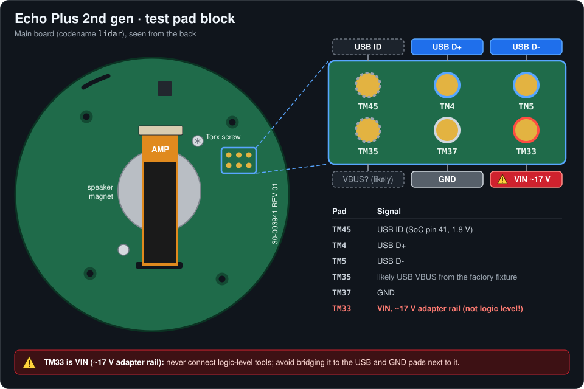

# lidar-mainline: U-Boot and mainline Linux for the Echo Plus 2nd gen

Mainline Linux v7.3 and U-Boot v2026.10 for the Amazon Echo Plus 2nd gen
(codename "lidar", MediaTek MT8516). It covers the bootloader, the kernel, and
the driver work that runs **after** the unlock. There is no exploit or unlock
code here: the device must already run Kaeru LK, as installed by
[`davidwatters/echo-plus-2-unlock`](https://github.com/davidwatters/echo-plus-2-unlock).

## Roadmap: compared with stock

✅ working · ⚠️ works, known issue · 🧪 implemented, needs testing on
hardware · 🛠️ planned · ➖ not planned. Details are under [Status](#status).

| Feature | Stock Fire OS | lidar-mainline |
|---|---|---|
| **Boot and system** | | |
| Bootloader | Amazon LK | ✅ U-Boot as a second stage after LK, USB fastboot, no UART input needed |
| Updates with automatic fallback | ✅ Amazon OTA | ✅ A/B slots with bootcount fallback (verified on hardware) |
| Recovery | ✅ | ✅ Kaeru fastboot (Action) and U-Boot fastboot (Volume Up) |
| Previous boot's log after a crash | ✅ ram_console | ✅ pstore console and panic logs |
| eMMC | ✅ | ✅ HS200 |
| CPU frequency scaling | ✅ | ✅ 598 MHz to 1.3 GHz with voltage scaling |
| CPU idle | WFI with several cores online | ✅ WFI, same as stock |
| Deep idle / suspend | ✅ via SPM firmware | ➖ |
| **Audio** | | |
| Speaker | ✅ | ✅ |
| 3.5 mm line-out | ✅ | ⚠️ works; start-of-stream crack not re-tested since the jack moved to the headphone drivers |
| Speaker crossover (woofer + tweeter) | ✅ | ✅ Amazon's filters in the DAC, amplifier mute against pops |
| Microphones (7) | ✅ | ✅ all 7 capture, shared (`lidar_mic8`, dsnoop, 48 kHz): 6 on a ring of 32 mm radius plus one in the centre. Mic 7 (centre) once showed narrow interference tones; a quiet-room measurement now puts it within 4 dB of the ring mics, 50 Hz-8 kHz. Beamforming with echo cancellation in `lidar-voice` (experimental) |
| Echo-cancellation reference | ✅ | ✅ playback loopback capture, bit-exact, shared (`lidar_ref`, dsnoop); used by `lidar-voice` and the sound display (`lidar-viz`) |
| Line-in | capture path in Fire OS's mixer config; use unclear | 🧪 not tested with a real source |
| **Wireless** | | |
| Wi-Fi (MT7668) | ✅ | ✅ scans 2.4 and 5 GHz, connects (tested on 5 GHz: 866 Mbit/s link); firmware from the unit's own Fire OS, kept on lidar's slot (`lidar-fireos`), MAC from IDME |
| Bluetooth (MT7668) | ✅ | ✅ classic and LE scanning, alongside Wi-Fi; ROM patch from linux-firmware. Bluetooth speaker for phones (A2DP, SBC and AAC) with the phone's volume as the system volume, paired by holding the action button (`bluetooth` service) |
| Zigbee hub (EFR32) | ✅ Amazon firmware | ✅ Zigbee coordinator next to Thread on one radio: `zigbeed` (EmberZNet 7.4.3) on the Echo, EZSP over TCP for Home Assistant (`zigbee` service) |
| Thread border router (EFR32) | ✅ | ✅ next to Zigbee on one radio: multi-PAN RCP built from this repository (`efr32/`), `otbr-agent` with its REST API for Home Assistant (`thread` service). Fire OS's own dual-PAN image speaks DSR's multiplexing and is not used |
| **Interface and sensors** | | |
| LED ring (12 RGB) | ✅ | ✅ boot animation; red while the mics are muted, volume arc (`ring` service) |
| Buttons, mic mute, privacy latch | ✅ | ✅ |
| Ambient light sensor | ✅ | ✅ relative readings (no lux calibration) |
| Temperature sensors | ✅ | ✅ |
| **Software** | | |
| Voice assistant | ✅ Alexa | 🛠️ local userspace: wake word (`lidar-wakeword` behind `lidar-voice`), the assistant core (`lidar-assistant`: timers, alarms, volume, music, time and date by typed command, English and German) and the speech model download (`lidar-models`) are there; speech recognition, speech output and Claude are not yet |
| Services, with settings | n/a | ✅ `lidar-feature`: core services on, extras off by default |
| Alexa cloud services | ✅ | ➖ |
| Kernel and U-Boot upstreaming | n/a | 🛠️ patch series drafted |

## Prerequisites

- An Echo Plus 2nd gen that is already unlocked and runs Kaeru LK.
- Your own full eMMC dump from the unlock, at least `boot_a`, for recovery.
- `fastboot` (Android platform-tools) and `podman` on the host.
- Network access while building: the test image downloads Alpine packages.
- Access to the USB test points (TM4, TM5 and TM37 below), for example with
  pogo pins; `pogo-jig/` is a printable jig for that. All flashing, the
  shell and the network go over this USB link.
- Optional: a 1.8 V UART adapter on TM58 (UART0 TX, 921600 8N1), output only.

### Test points

The USB and supply pads form a 2x3 block next to the AMP flex cable:



| Pad | Signal | Notes |
|---|---|---|
| TM4 | USB D+ | device-mode USB to the host |
| TM5 | USB D- | |
| TM37 | GND | |
| TM58 | UART0 TX | 1.8 V, 921600 8N1, kernel and bootloader log |
| TM33 | VIN, about 17 V (adapter rail) | next to USB D+/D- and GND: never connect logic-level tools, and avoid bridging it to neighbouring pads |
| TM45 | USB ID | SoC pin 41 (KPROW1, function `IDDIG`), 1.8 V logic; follows the pin's internal pull (1.8 V with pull-up, 0 V with pull-down). Pulled up by default (device role); leave unconnected |
| TM35 | probably USB VBUS from the factory fixture (unused) | near 0 V. Not a SoC GPIO: no response to pull changes on any free GPIO, and not UART0 RX. Unpowered: open to GND with the pad positive (even on 2 MΩ), ~600 Ω and a 0.61 V diode drop with GND positive, i.e. only a diode to ground. 5 V through 10 kΩ changed nothing the SoC can see (GPIO inputs, USB PHY monitor, MUSB DEVCTL); the board has no MT6392 PMIC to sense VBUS. Leave unconnected |

UART0 RX has not been found yet: none of the pads identified so far carries
it (TM35 was checked). No UART input is needed, see "U-Boot behaviour" below.

## Boot chain

```
BootROM -> preloader (BOOT0) -> BL31 -> Amazon LK + Kaeru
        -> boot_a | boot_b  (Android boot image, unverified because unlocked)
             payload = U-Boot (this project) -> extlinux on system_a | system_b
             (or: payload = Linux Image.gz + DTB, booted by LK directly)
```

Nothing here writes BOOT0/BOOT1, `lk_*`, `tee*`, `expdb`, `kb` or `dkb`.
Kaeru's fastboot lives in partitions this project never touches, so it is
always available for recovery: hold **Action** while plugging in power.

### What LK requires of a boot image

Taken from a stock `boot_a` and from strings in LK:

| Field | Value |
|---|---|
| Header | Android boot image v0, page size 2048 |
| Kernel | 512-byte MediaTek `KERNEL` header (magic `0x58881688`) + gzip(arm64 Image) + appended DTBs |
| DTB selection | LK picks the appended DTB whose **first** root compatible matches the board exactly (`amzn,lidar-pvt` on retail units). It copies it to `0x4e000000` (max 0x80000 bytes), fixes up memory and cmdline, and passes it in x0 |
| Entry | 64-bit, EL2, at `0x40080000`. BL31 occupies `0x43000000` + 0x30000, so the Image plus BSS must end below that |
| Cmdline | must start with `bootopt=64S3,32N2,64N2`, or LK does not take the 64-bit path |
| Ramdisk | required; plain gzip, no MediaTek header (an empty cpio works) |

`tools/lidarboot.py` builds exactly this (`pack`) and takes images apart
(`unpack`). It checks the arm64 magic, the BL31 overlap, the DTB size and the
DTB compatible. A stock image round-trips byte-identically after
decompression.

## Layout

| Path | What |
|---|---|
| `lidar-uboot/` | U-Boot v2026.10 overlay: `mt8516_amazon_lidar_defconfig`, board DTS, `MTK_LK_CHAINLOAD` Kconfig, boot environment `board/mediatek/mt8516/amazon_lidar.env`, `drivers/mmc/mtk-sd.c` (upstream copy with DMA for MT8516 and a bounce buffer for unaligned reads; check against upstream on version bumps) |
| `lidar-linux/` | Linux v7.3 overlay: board DTS, clock/reset fixes, RT5738 support in `rt5739.c`, LED fix, audio (AFE, machine driver, codec changes), `drivers/bluetooth/btmtksdio.c` (upstream copy with an MT7668 LE fix; check against upstream on version bumps), `drivers/tty/serial/8250/8250_mtk.c` (upstream copy without 16650 sleep mode, which wedges the UART's transmitter when data arrives on a closed port; check against upstream on version bumps), bindings |
| `lidar-wifi/` | MT7668 gen4 Wi-Fi driver ported from Amazon's GPL release, built out of tree |
| `lidar.config` | kernel config fragment applied on top of arm64 `defconfig` |
| `build.sh` | build entry point inside the container (targets listed in its header) |
| `Containerfile` | Debian build container with cross compilers and tools |
| `tools/lidarboot.py` | boot image pack/unpack for Amazon LK |
| `tools/mk-testimg.sh` | ext4 test system: kernel, DTB, Alpine initramfs with shells on UART and USB |
| `tools/alpine-fetch.py` | installs Alpine aarch64 packages into the test initramfs, pinned by `tools/alpine.lock`; `--update` rewrites the lock |
| `tools/mk-release.sh` | checks the built images (version, nothing that must not be passed on) and collects the release files with `SHA256SUMS` |
| `tools/devmem.c`, `tools/lidar-regdump.sh` | register access and a diffable dump of the SoC state for bring-up |
| `tools/lidar-bootanim.sh` | light-ring boot animation: twin comets over a drifting colour wheel, then a rainbow sweep and fade when boot completes |
| `tools/lidar-feature.sh` | service switches (core on, extras off by default) and settings in `/etc/lidar.conf` |
| `tools/lidar-listen.c` | TCP listener bound to one interface (`SO_BINDTODEVICE`); runs telnetd per connection |
| `tools/lidar-volume.sh` | system volume daemon: Bluetooth phones, volume buttons and CLI share one level and mute |
| `tools/lidar-ring.sh` | LED ring after boot: red while the mics are muted, volume arc on changes, the blue arc of Bluetooth pairing mode; hands the ring to `lidar-viz` in between |
| `tools/lidar-viz.c` | sound display on the LED ring (`visualizer` service): level arc or spectrum of whatever the speaker plays |
| `tools/lidar-voice.cc` | experimental: the voice of whoever speaks to the Echo, from all 7 mics: echo cancellation on every mic (WebRTC AEC3), 12 superdirective beams, the best beam by speech over noise, noise suppression; 16 kHz mono out, beam state for the ring and the web interface |
| `tools/lidar-wakeword.cc` | wake word detector ("Hey Jarvis") for the output of `lidar-voice`: microWakeWord model on TensorFlow Lite Micro, one line per detection (below) |
| `tools/mk-wakeword.sh` | fetches the pinned TensorFlow Lite Micro, microfrontend, FlatBuffers and KISS FFT sources and the wake word model, and builds `lidar-wakeword` for the test image or for the build host |
| `tools/lidar-assistant/` | voice assistant core (`assistant` service): English and German grammar for timers, alarms, volume, music, time and date, the actions behind it (also as a tool list for a language model), spoken answers as text; `lang/*.txt` hold each language's phrases and word lists, `build.sh test` runs its tests on the build host |
| `tools/lidar-radio.sh` | the EFR32 radio for Zigbee and Thread at once: uploads the multi-PAN RCP if needed and runs `cpcd`, `zigbeed` with its TCP bridge, and `otbr-agent`, with both networks kept on the booted slot |
| `tools/lidar-bluetooth.sh` | Bluetooth speaker: bluetoothd, bluealsa and its player, pairing mode on the action button with LED ring and sounds, the phone's volume tied to `lidar-volume`, pairing keys kept on the booted slot |
| `tools/lidar-efr32.sh` | the EFR32's Gecko bootloader from the SoC: start the application, upload an image, exchange bytes with the application |
| `tools/lidar-wifi.sh` | Wi-Fi client from `wifi ssid`/`passphrase` (`wifi` service): start, stop, status and scan; used at boot and by the web interface |
| `tools/lidar-fireos.sh` | the files lidar takes from Fire OS (Wi-Fi firmware, speaker tuning): kept on the booted slot, staged at boot, backup export and import |
| `tools/lidar-time.sh` | the clock (no RTC on this board): NTP once the network is up, the last synced time saved on the booted slot and set at the next boot |
| `tools/lidar-models.sh` | speech models of the voice assistant: downloads the recognizer and the voice of one language on the device, pinned by sha256; grows the system filesystem to its partition |
| `tools/lidar-xmodem.c` | XMODEM-CRC sender for the EFR32's Gecko bootloader |
| `tools/lidar-dsp.c` | speaker tuning as on Fire OS (`dsp` service): volume-dependent FIR EQ, parametric EQ, 4-band compressor/limiter, from the owner's Fire OS configuration |
| `tools/webui/` | web interface (`webui` service): `index.html` (the whole frontend) and `api.cgi` (BusyBox httpd CGI) |
| `tools/lidar-player.c` | plays the web interface's song library on the speaker, with fades on pause, stop and skip |
| `ucm2/MediaTek/amazon-lidar/` | ALSA UCM profile (alsa-ucm-conf layout) for PipeWire/PulseAudio: base routing as BootSequence, Speaker and Mic devices; the test image applies its BootSequence at boot |
| `pogo-jig/` | 3D-printable pogo-pin jig for the USB test points, held by one M4 screw in the bottom insert: OpenSCAD source, STLs, assembly notes and a test-fit checklist |
| `efr32/` | the EFR32MG12's multi-PAN RCP and `zigbeed` for the Echo (Gecko SDK 4.4.3, their own build container and a GBL packer); see `efr32/README.md` |
| `installer/` | browser installer (WebUSB): flashes U-Boot and the test system from a web page (see Installing); `installer/vendor/` holds fastboot.js; `.github/workflows/pages.yml` publishes the directory to GitHub Pages |

The overlays are copied over pristine upstream trees by `build.sh`. The
porting reference was Amazon's GPL release `Echo_Plus_2nd_Gen_src-6.5.7.1-20251021`,
which is not included.

## Building

Run from the repository root (bash on Linux, or Git Bash on Windows):

```sh
podman build -t lidar-build -f Containerfile .
podman volume create lidar-src
podman run --rm -v lidar-src:/src lidar-build bash -c '
  git clone --depth 1 -b v7.3 https://git.kernel.org/pub/scm/linux/kernel/git/torvalds/linux.git /src/linux &&
  git clone --depth 1 -b v2026.10 https://source.denx.de/u-boot/u-boot.git /src/u-boot'

W="$(pwd -W 2>/dev/null || pwd)"
run() { podman run --rm -v lidar-src:/src -v "$W:/work" lidar-build bash /work/build.sh "$@"; }
run uboot               # -> out/lidar-uboot.img
run linux lidar         # Image.gz, dtbs, modules in /src/build/lidar
# The zigbee and thread services need the EFR32's multi-PAN RCP and zigbeed,
# built in their own container (Silicon Labs' toolchain; see efr32/README.md)
# before testimg picks them up:
podman build -t efr-build -f efr32/Containerfile efr32
podman run --rm -v efr-src:/efr -v "$W:/work" efr-build bash /work/efr32/build.sh    # -> out/efr32/lidar-mp-rcp.gbl
podman run --rm -v efr-src:/efr -v "$W:/work" efr-build bash /work/efr32/zigbeed.sh  # -> out/zigbeed/zigbeed
run testimg lidar       # -> out/lidar-test-system.ext4 (also builds cpcd and ot-br-posix)
run bootimg lidar       # -> out/lidar-linux-boot.img (kernel booted straight from LK)
run patches             # -> out/patches/{linux,u-boot}-lidar.diff
```

The kernel boots without `clk_ignore_unused`: it gates every clock that is
on but unclaimed at the end of boot (the NFI, SPI-NOR, BSI, AES, SEJ, RBIST,
MSDC1 and debug gates, the APLL1 dividers, `memslp_dlyer` and `apxgpt`).
Tested on hardware with these gated: eMMC, I2C, microphones, the speaker (by
ear, with and without the speaker tuning), USB, LEDs, the light sensor,
Wi-Fi, Bluetooth and the EFR32 UART.

## Installing

1. **U-Boot.** Hold **Action** while plugging in (Kaeru fastboot), then:

   ```sh
   fastboot flash boot_a out/lidar-uboot.img
   fastboot reboot
   ```

   With an empty or unbootable system slot, U-Boot falls through to its own
   USB fastboot. Otherwise hold **Volume Up** at power-on to get there.
2. **Test system.** In U-Boot fastboot:

   ```sh
   fastboot -S 64M flash system_b out/lidar-test-system.ext4
   fastboot oem run:"setenv lidar_slot b; saveenv"
   fastboot reboot
   ```

   This erases `system_b`. If your Fire OS runs from slot b, use `system_a`
   and `lidar_slot a` instead.
3. **Shell.** The test system exports a root shell on a USB ACM gadget
   (`/dev/ttyACM0` on Linux hosts, a COM port on Windows). It also exports a
   USB NCM network interface: the device is `169.254.7.2/16`, so give the
   host's interface any other link-local address. If the `telnet` extra is
   on (an image you build yourself enables it, a release does not), a
   second root shell without authentication listens on
   `telnet 169.254.7.2` for when the serial shell
   is busy. By default it only accepts connections arriving on `usb0`; see
   `telnet listen` under Services.

**Previous boot's log:** after a warm reboot or a kernel panic (the kernel
reboots 10 s after a panic), `/sys/fs/pstore/` holds the previous boot's
console (`console-ramoops-0`) and crash report (`dmesg-ramoops-0`). The log
lives in a reserved RAM region at `0x60000000`, below U-Boot's fastboot
download buffer (`0x60100000`) and outside its kernel and initramfs load
area.

**Recovery:** hold **Action** while plugging in, then
`fastboot flash boot_a <your boot_a dump>` restores the stock boot path.

### Browser installer

`installer/` is a static page that does steps 1 and 2 from a desktop
Chromium browser (Chrome, Edge, Brave, Opera) over WebUSB. It needs what
the manual way needs: Kaeru fastboot already on the device, your own
`boot_a` dump, and the pogo-pin USB. It contains no unlock code.

- One click on "Download and use" fetches the latest published release's
  two images and checks them. A page cannot fetch GitHub release assets
  (their download URLs redirect to a host without CORS headers, tested),
  so the Pages workflow (`.github/workflows/pages.yml`, run again for every
  published release) puts the release's images, gzipped (about 37 MB), and
  `release.json` with their SHA-256 next to the page; the page unpacks them
  and compares them with that and with the `digest` the GitHub API gives
  for each release file. Files you download or build yourself can still
  be picked: they are checked against the release, or against a
  `SHA256SUMS` you pick, and otherwise flashed as "not verified" after a
  warning. Nothing is uploaded.
- For each phase a photo of the Echo's top shows the button to hold,
  circled: Action for Kaeru fastboot, Volume Up for U-Boot's.
- It writes `boot_a` and `system_b` only and refuses any other partition.
  If your Fire OS runs from slot b, install by hand as above.
- Before each flash it checks which fastboot answers (Kaeru's for `boot_a`,
  U-Boot's for `system_b`) and asks for confirmation. It does not read the
  serial number.
- Windows: the fastboot device must use the WinUSB driver; the page explains
  how. Linux may need a udev rule for USB ID `0bb4:0c01`.
- To run it locally: `python -m http.server` in `installer/`, then open
  `http://localhost:8000/` (WebUSB needs https or localhost, and the page
  does not work from `file://`).
- **Not yet tried on an Echo.** Both phases, wrong-mode and foreign
  devices, a failed flash and a lost USB connection were only run against
  a simulated fastboot device in the browser. Open on hardware: the Windows
  driver steps, the udev rule, how Kaeru's fastboot answers the page's
  `getvar` queries, whether U-Boot accepts the page's sparse pieces, and
  the GitHub Pages workflow.

USB access uses [fastboot.js](https://github.com/kdrag0n/fastboot.js) v1.1.3
(MIT), vendored unmodified in `installer/vendor/` with its licence and
checksum.

### Releases

A tag `vMAJOR.MINOR.PATCH` (annotated; its message becomes the release
notes) makes `.github/workflows/release.yml` build `lidar-uboot.img` and
`lidar-test-system.ext4` in the container and open a draft release with
them, `SHA256SUMS` and `lidar-release.txt` (kernel, Alpine packages). A
suffix (`v1.3.0-rc.1`) marks a pre-release. The image reports its version
in `/etc/lidar-release` (`local` for your own builds), and the web
interface shows it.

Release images differ from the ones you build yourself:

- No Silicon Labs software (`LIDAR_NO_SILABS=1`), so no Zigbee and no
  Thread: build the image yourself for those (`efr32/`).
- The `telnet` extra is off.

`tools/mk-release.sh` checks the image before a release is made and
refuses one with MSLA software, Fire OS files, settings or telnet in it.
The sources of the Alpine packages listed in `lidar-release.txt` are in
Alpine's [aports](https://gitlab.alpinelinux.org/alpine/aports) tree.

**Pins.** One commit builds the same images every time, or not at all:
Linux and U-Boot by tag (`build.sh`), everything else the build downloads
by commit or SHA-256 (`tools/mk-testimg.sh`, `tools/mk-wakeword.sh`), the
Alpine release and each package with version and SHA-256 in
`tools/alpine.lock`. Alpine serves only the newest build of a package, so
the lock goes stale when Alpine updates one, and the build then stops and
names it. To bump, or after adding a package to `mk-testimg.sh`:

```sh
podman run --rm -v "$PWD:/work" lidar-build python3 /work/tools/alpine-fetch.py --update [new-package...]
```

and commit the lock. For an older tag whose packages Alpine no longer
serves, use that release's images.

## Services

Services sit on top of the base system, in two groups:

- **Core** services make the device work on its own, as on stock: system
  volume, LED ring, Wi-Fi, the Bluetooth speaker, the speaker tuning and the
  boot animation. They are **on by default**. A system that brings its own
  (its own volume handling or LED daemon, say) turns the matching service
  off so the two do not fight over the same controls.
- **Extras** are for development and integration: everything on the USB
  port beyond the serial shell and network (web interface, telnet) and the
  Zigbee and Thread radio. They are **off by default**.

Services do not require each other, with one exception: `thread` with
`thread infra wlan0` (the default) needs `wifi` and does not start without
it (it says so in the kernel log). Otherwise one that misses another falls
back and logs it: Bluetooth without `volume` lets the phone's volume scale
the samples, `dsp` without `volume` (or without Amazon's tuning files)
leaves the speaker untuned. Wi-Fi and Bluetooth share one chip: with either
on, the Wi-Fi firmware is staged (from Fire OS on `system_a`, or lidar's
copy of it: see Files from Fire OS) and the WLAN driver loads, which
Bluetooth needs first; `wifi` off then only means no network is joined.
Without the firmware there is neither, and the Bluetooth services wait
quietly.

The former `wireless` service is now `wifi`: in `lidar.conf`,
`feature.wireless` becomes `feature.wifi` and `wireless.ssid`,
`wireless.passphrase`, `wireless.country` become `wifi.ssid` and so on.
Its `wireless bluetooth` setting is gone: the `bluetooth` service, now on
by default, decides (`lidar-feature disable bluetooth` keeps the radio
off).

The switches and settings live in `/etc/lidar.conf` on the root filesystem
of the slot that booted, one `key=value` per line: `feature.<name>=0|1` and
`<name>.<key>=<value>`. This file belongs to the OS. The U-Boot environment
in `misc` only holds boot state (`lidar_slot`, `bootcount`,
`upgrade_available`). Because the file is per slot, an updater that wants
to keep the owner's choices copies it into the new slot.

Earlier builds stored these in the U-Boot environment
(`lidar_feature_*`, `lidar_setting_*`); those variables are ignored now.
Flashing a slot's image replaces its `/etc/lidar.conf`, so the image's
choices (telnet included) come back. Changing a service needs a shell on
the device, or editing the file in the image before flashing.

An image you build yourself ships an `/etc/lidar.conf` that also enables
the `telnet` extra; a release's is empty. U-Boot passes the booted slot as
`lidar.slot=${lidar_slot}` on the kernel command line, and the test image
mounts that slot read-only at
`/media/system`. If it cannot, the defaults apply.

```sh
lidar-feature list                 # group, current state and defaults
lidar-feature disable telnet       # takes effect on the next boot
lidar-feature reset telnet         # back to the default (off)
```

| Service | Group | Default | What it does |
|---|---|---|---|
| `bootanim` | core | on | light-ring animation while booting |
| `volume` | core | on | system volume for the speaker (below) |
| `ring` | core | on | LED ring after boot: red while the mics are muted, volume changes, Bluetooth pairing mode (below) |
| `wifi` | core | on | Wi-Fi client: joins the network in the `wifi` settings at boot; the clock comes from NTP once online |
| `bluetooth` | core | on | Bluetooth speaker for phones (below) |
| `dsp` | core | on | speaker tuning as on Fire OS (below); needs the `volume` service and Amazon's tuning files (Fire OS on `system_a`, or lidar's copy), takes effect on reboot |
| `webui` | core | on | web interface on port 80 of the USB network, with the first-run setup (below) |
| `telnet` | extra | off | root shell without authentication on port 23 of the USB network (`169.254.7.2`) |
| `zigbee` | extra | off | Zigbee coordinator for Home Assistant (ZHA) on TCP port 6638 (below); runs alongside `thread` on the same radio |
| `thread` | extra | off | Thread border router for Home Assistant, REST API on port 8081 (below); runs alongside `zigbee` on the same radio |
| `visualizer` | extra | off | sound display on the LED ring (below) |
| `assistant` | extra | off | voice assistant core: timers, alarms, volume, music, time and date by typed command (below) |
| `voice` | extra | off | wake word "Hey Jarvis" with the beamformer, direction on the ring, a chime; about one CPU core (Wake word, below) |

Settings are refused if invalid, and a missing or invalid entry means the
default. Most take effect on the next boot; the live ones apply at once,
because what reads them does so where it uses them or is told: `dsp bass`,
`mid`, `treble`, `boost`, `visualizer style` (the display restarts with
it), `ring min_brightness`, `volume sound` and
`ring`, `bluetooth sound` and `pair_seconds`, and those the web interface
applies itself (Wi-Fi network, API key, login). Init keeps a copy of
`lidar.conf` as it was at boot (`/run/lidar.conf.boot`), so `lidar-feature
pending` lists only changes that still differ from what runs: setting a
value and back again leaves nothing to reboot for.

```sh
lidar-feature settings [feature]          # values in effect, defaults, allowed
lidar-feature get telnet listen           # prints the value in effect
lidar-feature set wifi country DE         # takes effect on the next boot
lidar-feature set voice api_key < keyfile # no value: the first line of standard input
lidar-feature unset wifi country          # back to the default
lidar-feature pending                     # what still waits for a reboot
```

| Setting | Default | Allowed | What it does |
|---|---|---|---|
| `telnet listen` | `usb` | `usb`, `any` | `usb`: only connections arriving on `usb0` are accepted. `any`: every interface, so the passwordless root shell is open to the Wi-Fi network too |
| `wifi country` | unset | two capital letters | regulatory domain, requested with `iw reg set` once the WLAN driver is loaded. Unset leaves the driver's and firmware's default |
| `wifi ssid` | unset | 1-32 bytes | Wi-Fi network (WPA2-Personal) to join at boot, with `wifi passphrase`; the address comes from DHCP (`udhcpc`) |
| `wifi passphrase` | unset | 8-63 printable ASCII characters | passphrase of that network. Stored in plain text in `lidar.conf`, which only root can read; `lidar-feature settings` shows it as `(set)` |
| `volume max_attenuation` | 0 | 0-60 | cap in dB: full volume is this far below the codec's 0 dB. 0 is Amazon's maximum; raise it to keep the speaker quieter |
| `volume initial` | 30 | 0-100 | volume at boot, in percent of the range up to the cap |
| `volume ring` | `on` | `on`, `off` | show volume changes on the LED ring (needs the `ring` service) |
| `volume sound` | `on` | `on`, `off` | short tone at the new level when the volume buttons change it |
| `volume keepalive` | `on` | `on`, `off` | `off`: no silent stream holding the speaker output open. No idle amplifier hiss, but every sound then clicks at its start and end |
| `dsp bass` / `dsp mid` / `dsp treble` | 0 | -6..6 | tone in dB on top of the speaker tuning: shelf below 120 Hz, peak at 800 Hz, shelf above 6 kHz. Applies at once |
| `dsp boost` | 0 | 0-6 | loudness boost in dB into the tuning's compressor and limiter: louder at the same volume, peaks stay limited. Applies at once |
| `ring auto_brightness` | `on` | `on`, `off` | ring brightness follows the ambient light sensor, as on stock; `off`: always full |
| `ring min_brightness` | 15 | 5-100 | ring brightness in a dark room, in percent of full |
| `zigbee listen` | `usb` | `usb`, `any` | `usb`: the coordinator port only accepts connections on `usb0`; `any`: on every interface, Wi-Fi included |
| `thread infra` | `wlan0` | `wlan0`, `usb0` | the network Home Assistant is on: the border router routes between it and the Thread network and advertises the Thread network there. `wlan0` needs the `wifi` service |
| `thread listen` | `usb` | `usb`, `any` | `usb`: the REST API sits on a unix socket that `lidar-listen` bridges to port 8081 for connections arriving on `usb0` only (`SO_BINDTODEVICE`, as for telnet); `any`: otbr-agent listens on every address, Wi-Fi included. The API has no authentication and can change the Thread network |
| `bluetooth name` | `lidar` | 1-48 bytes | name phones show for the Echo |
| `bluetooth pair_seconds` | 120 | 30-600 | how long pairing mode lasts |
| `bluetooth sound` | `on` | `on`, `off` | a double blip every 3 s in pairing mode, a chime when a phone pairs or connects, a falling tone when pairing mode ends without one |
| `visualizer style` | `level` | `level`, `spectrum` | `level`: an arc from LED 1 down both sides, green, yellow, red at the end, with a peak mark; longer with louder music and a higher volume. `spectrum`: 7 bands from 50 Hz to 10 kHz, mirrored, bass at LED 1 and treble opposite, red to violet |
| `webui listen` | `usb` | `usb`, `any` | `usb`: the web interface only accepts connections on `usb0`; `any`: on every interface, Wi-Fi included |
| `webui storage_mb` | 256 | 64-512 | RAM for uploaded songs, in MB (about 11 minutes of music per 128 MB), a RAM disk of its own; the library is cleared on reboot |
| `webui setup_done` | `no` | `no`, `yes` | `yes`: the first-run setup of the web interface was finished. `no`: the web interface opens it for clients on the USB network |
| `webui auth` | `off` | `off`, `wifi`, `all` | login for the web interface (below). `wifi`: asked of clients that are not on the USB network. `all`: of USB clients too. Set from the web interface, which stores the two settings below with it |
| `webui auth_kind` | unset | `pin`, `password` | what the login is, so the page asks for the right thing |
| `webui auth_hash` | unset | sha512-crypt hash | hash of the PIN or password, as `cryptpw -m sha512` prints it; `lidar-feature settings` shows it as `(set)`. Without it there is no login, whatever `webui auth` says |
| `webui fireos_image_saved` | `no` | `no`, `yes` | `yes`: the owner confirmed in the setup that the Fire OS image (`system_a`) was downloaded and saved. Nothing else depends on it yet |
| `voice wake_word` | `hey_jarvis` | `hey_jarvis` | word the voice assistant listens for; the only one for now |
| `voice language` | `en` | `en`, `de` | language the voice assistant understands and speaks: English, German |
| `voice timezone` | `UTC0` | POSIX TZ string | time zone of alarms and the time, e.g. `CET-1CEST,M3.5.0,M10.5.0/3` (Central Europe) |
| `voice ring_volume` | 30 | 0-100 | volume an alarm or timer rings at, at least; the speaker is unmuted for it. 0: volume and mute stay as they are |
| `voice voice_de` | `thorsten` | `thorsten`, `eva_k` | German voice: natural and slower, or smaller and about twice as fast; installed by `lidar-models` |
| `voice sensitivity` | `medium` | `low`, `medium`, `high` | how readily the wake word triggers: `low` misses more, `high` triggers more often by mistake |
| `voice api_key` | unset | 16-200 printable ASCII characters, no spaces | Claude API key of the voice assistant. Stored in plain text in `lidar.conf`, which only root can read; `lidar-feature settings` shows it as `(set)` |

- `voice` is a group of settings without a service switch: it does not
  appear in `lidar-feature list`. The `assistant` service reads `voice
  language`, `timezone` and `ring_volume`; `lidar-wakeword` does not take
  its cutoff from `voice sensitivity` yet.
- `lidar-feature set <name> <key>` without a value reads it from standard
  input, which keeps a passphrase or key out of the process list. The web
  interface hands on setting values and the Wi-Fi passphrase that way.
  Verified on hardware with `voice api_key` (set and unset).
- The telnet restriction is a socket bound to `usb0` with `SO_BINDTODEVICE`
  (`tools/lidar-listen.c`), not a packet filter: the kernel only matches
  the listener for connections that come in on `usb0`, whatever address
  they are sent to. If `usb0` is missing, telnet does not start. The USB
  host, and whatever that host forwards onto the USB network, still gets a
  root shell without a password. Not yet verified on hardware.
- `wifi country` has not been tried on hardware.
- `wifi ssid`/`passphrase`: verified on hardware. The configuration
  that `wpa_supplicant` gets (SSID as hex, the PSK from `wpa_passphrase`,
  also for passphrases with `"`, `#` and spaces) and a real join from the
  web interface: WPA2 on 5 GHz, address, default route and DNS from DHCP.
- The clock: the board has no real-time clock (no PMIC on it, as on
  stock), so it starts at 1970 on every boot. `lidar-time` sets the last
  time it saved before the services start, and BusyBox `ntpd` sets the
  real time from `pool.ntp.org` once there is a default route and a DNS
  server; every sync is saved on the booted slot. Verified on hardware:
  the saved time at 2.7 s after boot, NTP at 10 s over Wi-Fi. The clock
  runs in UTC.

### System volume

`lidar-volume` (the `volume` service) owns one speaker volume and mute, applied
to the codec's `PCM Playback Volume` in 0.5 dB steps up to the safety cap.
Volume 0 is silence: the codec's lowest step (-63.5 dB) is still audible, so
0 mutes like the mute flag (in `lidar-dsp`'s samples with the speaker tuning,
otherwise through the codec's DAC-to-driver switches). Everything that
changes volume feeds the same state:

- **Bluetooth phone** (`bluetooth` service): the phone's volume buttons and
  slider set the level, and changes made on the Echo move the phone's
  slider (see Bluetooth speaker).
- **Volume buttons:** 3 dB per press; holding repeats after 0.4 s, one step
  every 0.15 s. A short 520 Hz tone plays at the new level on the press and,
  after a hold, once at the final level, as on stock.
- **Command line:** `lidar-volume get | set <percent> | up | down | mute |
  unmute | toggle`.

With the `ring` service, every change shows as a white arc on the LED ring
(the leading LED dims in between, so each step is visible; while the speaker
is muted the same arc shows dimmed, so the level it comes back at stays
visible), which goes back to the ring's normal state 2 s after the last
change.

The service also holds the speaker output open with a silent stream, as stock
keeps its output open between sounds. Measured with the Echo's own mics:
every time the codec stream starts or stops, it clicks, either because the
SoC stops the DAC's clocks or, if the amplifier is muted around that,
because the amplifier's mute pin itself clicks when it switches. With the
stream held open, sounds start at once and without clicks. Expect a faint
amplifier hiss, as on stock.

Without the `volume` service the speaker stays at the test image's base level
(-40 dB).

### Speaker tuning

Fire OS does not play audio flat: its audio library (`libasp.so`) runs every
speaker stream through a chain configured by
`/system/vendor/etc/audio-algorithms/AFE.cfg`. The `dsp` service runs the
same chain, reverse engineered from that library, on the owner's own copy of
these files (from `system_a` or lidar's copy of them, at boot; nothing is redistributed):

1. the volume, applied digitally before everything else, as on stock;
2. a 2048-tap FIR equalizer chosen by the level (`EQ_50/90/100.cfg`): the
   speaker's response correction plus loudness compensation, +10 dB of bass
   up to -23.5 dB, +5 dB up to -4 dB, none above; a level change crosses
   zones with a 400 ms crossfade;
3. the parametric EQ (`ParametricEQ.cfg`: bass shelves +3 dB at 70 Hz and
   +9 dB at 110 Hz, -3 dB at 160 Hz);
4. the owner's tone settings, if any (`dsp bass`, `mid`, `treble`, ±6 dB:
   the three bands of stock's own user EQ, which Fire OS ships flat) and
   `dsp boost` (0 to 6 dB of gain);
5. the multiband compressor/limiter (`MBCL.cfg`): +6 dB in, four bands
   (100/220/5000 Hz Linkwitz-Riley crossovers), a slow RMS compressor and a
   2 ms look-ahead peak limiter per band, a full-band limiter, a hard clip;
6. both channels mixed to mono for the single speaker.

So with the service on, the same volume percentage is noticeably louder and
fuller than without, as on stock, and the compressor only works hard near
full volume. The limiters keep the output below digital full scale; the
safety cap still applies, since the codec sits at the cap and the volume is
taken off digitally. The line-out jack gets the same tuned mono signal
(stock bypasses the chain for external outputs).

Tone and boost sit in front of the compressor/limiter, so whatever is set,
every band and the sum stay below full scale: more bass or boost makes the
compressors work harder instead of the speaker. Near full volume a boost
therefore adds little; at low and middle volumes it is the full 6 dB.
`lidar-feature set dsp bass 3` applies at once while the tuning runs
(`lidar-dsp` re-reads the settings on SIGHUP and crossfades to them in 20
ms, without clicks), otherwise when it next starts; a tuning without a
multiband compressor leaves tone and boost off, since nothing would limit
them. With all four at 0 the output is bit for bit that of the tuning
alone. Verified
on the PC: response as set, output identical with all at 0, peaks capped at
full scale with everything at +6, no step larger than the signal's own on a
change.

How it runs: the mixed speaker stream (dmix) goes into `snd-aloop`, clocked
by the codec, and `lidar-dsp` processes it in 8 ms frames into the codec
(32 bit). `lidar-volume` writes the level to `/run/lidar-dsp/volume` and
parks the codec at the cap only while `lidar-dsp` runs and reports that its
output is live, so a stopped DSP can only make the speaker quieter. While
it is stopped, sound clients wait; init restarts it. `lidar-dsp` holds the
codec open all the time, so `volume keepalive off` makes no difference with
it. It adds about 60 ms of latency and takes about 13% of one core at
1.3 GHz. Without the `volume` service or the tuning files the speaker stays
on the plain path. Toggling the service takes effect on the next boot.

Verified: the impulse response at low level matches the stock FIR and EQ
times the MBCL band gains (+11 dB below 100 Hz, +8 dB above 220 Hz), the
limiter keeps full-scale noise below 1.0, and on the device the processed
stream arrives at the codec as computed offline. By ear, against the plain
path at the same volume: clearly fuller, closer to stock, without
distortion, clicks or dropouts.

### Files from Fire OS

Two things lidar cannot ship, because they are Amazon's and not
redistributable, come from the owner's Fire OS: the Wi-Fi firmware (which
Bluetooth needs too) and the speaker tuning. `lidar-fireos` keeps a copy of
both on the booted slot (`/var/lib/lidar-fireos`, like the pairing keys):
at every boot it refreshes the copy from `system_a`, writing only what
changed, and stages the copy. Once it exists, a wiped `system_a` no longer
matters.

- **Back it up.** An Echo whose Fire OS is gone and that has no copy has no
  Wi-Fi, no Bluetooth and no tuning until a backup is imported: `lidar-fireos
  export <file>` / `import <file>`, or "Download backup" / "Restore backup"
  under System in the web interface (USB network only). Never publish it.
- **What is needed** (tested on hardware by removing files): of the Wi-Fi
  files only the two RAM code images. Without `EEPROM_MT7668.bin` the driver
  uses the chip's own eFuse calibration; without `wifi.cfg` its defaults;
  without `TxPwrLimit_MT76x8.dat` power is limited by the kernel's
  regulatory database alone (set `wifi country`). Each of these still gave
  the same 5 GHz link at 866 Mbit/s. The tuning needs `AFE.cfg`.
- **Import checks:** only the known file names as plain files (no links,
  no paths), the RAM code images at plausible sizes, and a tuning that
  `lidar-dsp` accepts; otherwise nothing is written.
- The copy lives on one slot: a new slot starts from Fire OS again, or from
  an import.

### Web interface

With the `webui` service, `http://169.254.7.2/` on the USB host shows the
Echo's state, plays music on it and holds every setting, also without
Wi-Fi or Bluetooth set up. It is one page without anything loaded from
elsewhere, with a light and a dark theme, a side bar on wide screens and,
on a phone, four shortcuts at the bottom and the whole menu under "More".
Each service switch and each setting sits in the category it belongs to:

- **Overview:** the LED ring as it is lit, the system volume and mute
  (`lidar-volume`), what plays, the privacy switch, whether the speaker
  tuning runs, Wi-Fi and Bluetooth at a glance, CPU load, memory, the three
  board temperature sensors, the clock, the light sensor, USB traffic and
  the supply rails.
- **Music:** songs are dropped onto the page; the browser decodes them (any
  format it can play), converts them to 48 kHz 16-bit stereo and uploads
  them. `lidar-player` plays the library in order, with pause, seek and
  skip. The library lives in RAM (`webui storage_mb`) and is gone after a
  reboot.
- **Sound:** the volume and its settings (`volume initial`,
  `max_attenuation`, `sound`, `keepalive`), the tone controls as sliders
  (`dsp bass`, `mid`, `treble`, `boost`, heard while they move; "Flat" puts
  bass, mids and treble back to 0) and the `volume` and `dsp` services.
- **Voice:** the `assistant` and `voice` services, wake word, sensitivity,
  language (and the German voice with German), the Claude API key
  (write-only, with a test), the time zone (common ones by city, any other
  as a POSIX TZ string) and the alarm volume. "Listening" draws the Echo
  from above, five times a second while the view is open: Volume down at
  the top, the microphone button on the right, Volume up at the bottom,
  Action on the left, and around it the twelve beams of `lidar-voice` as
  bars (how far each is over the noise), the one in use coloured; the ring
  lights up towards a wake word when one is heard. "Type to the assistant"
  sends a line as if it had been spoken and lists what was understood and
  answered; below it, what rings, the timers with their time left and the
  alarms.
- **Light ring:** the ring as it is lit, the `ring`, `visualizer` and
  `bootanim` services, brightness (`ring auto_brightness`,
  `min_brightness`), `visualizer style` and the volume arc (`volume ring`).
- **Wi-Fi:** status (network, signal, band, bit rate, addresses), a scan
  list to pick a network from, connect (saved as `wifi ssid` and `wifi
  passphrase` and joined at once, through `lidar-wifi`) and forget, the
  `wifi` service and `wifi country`.
- **Bluetooth:** with the `bluetooth` service (it loads the Bluetooth
  driver): power, the speaker's state, pairing mode on and off, the paired
  phones with a button to forget each, a scan of nearby devices (name,
  address, type, signal) through `btmgmt`, and the `bluetooth` settings.
- **Smart home:** the `zigbee` and `thread` services with their settings
  and state (Thread: role, network, channel, PAN ID, border routing).
- **Security:** the login (below), `webui listen`, and `telnet` with
  `telnet listen`. Switching `telnet` on asks first: it is a root shell
  without a password for everyone on the USB network.
- **System:** release and kernel, reboot, "Run setup again", the `webui`
  service (switching it off asks first) and `webui storage_mb`, the files
  from Fire OS with backup and restore, and the download of the Fire OS
  image.
- **Debug:** the kernel log with a filter and live follow, the previous
  boot's log from pstore (after a crash or a warm reboot), processes,
  storage, mounts and modules.
- **Files:** a read-only file browser with text preview (first 256 KB) and
  download. Device nodes, `/proc/kmsg`, `/proc/kcore`, process memory and
  debugfs are refused: reading some of them blocks, and debugfs register
  dumps of clock-gated blocks can stall the bus. `lidar.conf` on the
  booted slot and its copy from boot (`/run/lidar.conf.boot`) are refused
  too, because they hold the Wi-Fi passphrase, the API key and the login's
  hash. Everything else is served.

A switch, slider or choice is sent the moment it is used, and its row says
what became of it. What waits for a reboot is the Echo's to say
(`lidar-feature pending`): while that list holds anything, a bar with
"Reboot now" stays at the top and the rows in it say "after reboot"; a
change taken back leaves the list again, and after a reboot it is empty.
The page asks for it when a view opens, after every change and when the
Echo is back. In the API, `set`, `unset`, `enable` and `disable` answer
`{"ok": true, "reboot": true|false, "pending": <how many wait>, "message":
"<what lidar-feature printed>"}`, and `pending` answers `{"pending":
["feature.<service>", "<feature>.<key>", ...]}`. The controls follow what
`lidar-feature` allows (`on|off` a switch, a range a slider, a few values
buttons, more a list). A service or setting the page has no place for yet,
from a newer image, shows under "Advanced" in the category of its service,
or under System, so none is ever missing. Over Wi-Fi the switches show but
are disabled, and the settings are not sent (see Login below).

For the Voice view the API has `voice`, which answers `{"voice": ...,
"wake": ..., "assistant": ...}` with the contents of
`/run/lidar-voice.json`, `/run/lidar-wake.json` and
`/run/lidar-assistant.json` (`null` for one that is not there), and
`assistant_say` (POST, `application/octet-stream`, one line of at most 300
bytes): the line goes to `/run/lidar-assistant.fifo`, and the answer, after
at most 3 s, is `{"answered": true|false, "assistant": <its state>}`, whose
`last` is the answer to that line if `answered` is true. Both are for the
USB network only.

**First-run setup.** Until it has been finished once (`webui setup_done`),
the web interface opens a setup for clients on the USB network; "Run setup
again" under System starts it later. Every step can be skipped.

1. *Protect the web interface*: a PIN or password for the web interface,
   and of whom it is asked (see Login below). Skipping it leaves the web
   interface open.
2. *Fire OS files*: shows whether lidar's copy of the Wi-Fi firmware and
   the speaker tuning is complete, and restores a `lidar-fireos export`
   backup if not (see Files from Fire OS).
3. *Fire OS image*: downloads the whole Fire OS partition (`system_a`) as
   `fireos-system_a.img.gz`, offered when lidar booted from slot b and
   Fire OS is still on `system_a`. The partition is only read, never
   mounted. The image is private: keep it, never share or publish it.
   Ticking "I saved the file" sets `webui fireos_image_saved`.
4. *Wi-Fi*: scan and join, as under Wi-Fi.
5. *Device name*: the name phones show for the Bluetooth speaker
   (`bluetooth name`), after a reboot. It is not a network hostname.
6. *Voice assistant*: wake word, language, sensitivity and the Claude API
   key (the `voice` settings). The web interface never returns the key,
   only whether one is set and its last four characters. "Test key" asks
   the Anthropic API for its model list from the Echo, over TLS with the
   key on `socat`'s standard input; it needs Wi-Fi and a set clock. Speech
   recognition, speech output and Claude are not part of the image yet:
   these settings are stored for them.

The setup adds these to the API: `setup` (finished or not, whether this
client may run it, and the state of the login; answered for everyone),
`fireos_image` (the gzip stream), `voice_key` (set or not, last four
characters) and `voice_key_test` (`ok`, `invalid`, `offline` or `error`);
`fireos` also reports `image_bytes`, the partition size.

Verified on hardware, through the API: `setup`, `voice_key`, setting and
removing the key, `voice_key_test` with a made-up key (`invalid`, so the
TLS connection and the certificate check work), the `fireos_image` stream
(about 6 MB/s of partition data, a valid gzip file) and the refusal of
`lidar.conf`. A key test with a valid key has not been run, and the pages
of the setup were walked through in a desktop browser against a mock
backend, not against the Echo.

**Login.** The owner can protect the web interface with one PIN (digits
only, at least 6) or one password (at least 10 printable ASCII characters);
there are no user names. It is set in the first step of the setup and
changed or removed under Security, Login, and `webui auth` says of whom it is
asked:

- `off` (the default until one is set): no login.
- `wifi`: clients that are not on the USB network have to log in; the USB
  network stays open as before.
- `all`: clients on the USB network have to log in too.

A client that has to log in gets nothing but the login form: every request
to the API is refused without a session, downloads included, except `setup`
and `login`. A PIN is fine against people in the same room; where the web
interface is open to the Wi-Fi (`webui listen any`), prefer a password, and
the page says so when a PIN is chosen there.

- **What is stored.** Only a sha512-crypt hash with a random salt
  (`cryptpw -m sha512`) in `webui auth_hash`, in `lidar.conf`, which only
  root can read and the file browser refuses. The PIN or password reaches
  `cryptpw` on standard input and is never an argument, a log line or a
  file. A login is checked by hashing it again with the stored salt.
- **Sessions.** A login puts a random token (32 bytes from `/dev/urandom`)
  into the cookie `lidar_session` (`HttpOnly`, `SameSite=Strict`), good for
  30 days. The Echo keeps only its SHA-256, under `/run/lidar-webauth`, so
  every browser logs in again after a reboot. "Log out" ends the session;
  changing the PIN, the password or `webui auth` ends all of them, and the
  browser that made the change stays logged in.
- **Wrong attempts.** Failed logins are counted per client address. From
  the 5th in a row on, each one locks that address: 10 minutes, then 30
  minutes every time; the answer says how many seconds are left,
  and the page counts them down. A right login resets the count. All
  failures from outside the USB network are counted together as well and
  lock every such client in the same way from the 20th in a row, so
  changing the address does not help. The USB network is not held up by
  that count: nobody on the Wi-Fi can lock the owner out of it. The counts
  are gone with a reboot.
- **What a login does not do.** It does not make a client admin: with or
  without it, everything that changes the device or reads more than its
  status (Wi-Fi and Bluetooth control, services and settings, logs, files,
  reboot, the login itself) is only answered for clients on the USB network
  (`169.254.0.0/16`). Over Wi-Fi a logged-in client gets the dashboard, the
  volume, music and the network status, as every Wi-Fi client does without
  a login set. Changing or removing the login needs a session or the
  current PIN or password.
- **Forgotten.** Restart the Echo and, once the ring lights up (the boot
  animation; not while plugging in, where Volume up alone enters U-Boot's
  fastboot), hold **Volume up** and **Volume down** together until the
  ring flashes green three times, about 10 seconds; start within the first
  30 seconds. That removes `webui auth`, `auth_hash` and `auth_kind` and
  ends every session; the kernel log has a line. The volume may shift a
  little meanwhile. Not the
  microphone button: every press toggles its hardware mute latch. Whoever
  can touch the Echo can do this; the login protects against the network,
  not against hands. On a shell, `lidar-feature unset webui auth` turns the
  login off.
- **No TLS.** The web interface is plain HTTP: the PIN or password, the
  session cookie and everything else cross the network unencrypted, and
  whoever can listen in on the Wi-Fi can read them. Use it in your own
  network only. Never forward a port to it or otherwise open it to the
  internet; for access from outside, use a VPN into the home network.

The login adds `login` (body: the PIN or password; sets the cookie, or
answers `{"error": ..., "wait": <seconds>}`), `logout` and `auth_set`
(body, one per line: `off`, `wifi` or `all`; `pin` or `password`; the
current PIN or password, needed unless none is set or the browser is logged
in; the new one, or empty to keep it) to the API. A request that needs a
login gets `{"error": "login required", "login": true}`. `set` and `unset`
refuse the three `webui auth` settings. For scripts: log in once with
`curl -c cookies.txt`, then pass `-b cookies.txt`.

Verified on the Echo: setting a PIN, every request and download refused
without a session, the cookie (`HttpOnly; SameSite=Strict`, 30 days), the
lockout at the 5th wrong PIN (with the earlier 60 s step) refusing even the
right PIN until it ended, logout, removing the login, and the button reset
with both volume buttons (three green flashes, login gone). One check of a
PIN takes about 0.3 s. Not yet tried on the Echo: the 10 minute lockout
step itself (the same code path with a longer time).

As with telnet, the server (BusyBox `httpd` behind `lidar-listen`) only
accepts connections that arrive on `usb0` unless `webui listen any` is set.
Unlike telnet, a web server can also be reached by other web pages open in
the host's browser, so the API only takes commands
as POST with `Content-Type: application/json`, or `application/octet-stream`
for those that carry data (uploads, Wi-Fi credentials, setting values, the
login), which a foreign page cannot send without a CORS preflight that the
server never answers, and only when the Echo is addressed by IP (no DNS
rebinding). Everything on the page comes from `/cgi-bin/api` as JSON, so
scripts can use it too:

```sh
curl 'http://169.254.7.2/cgi-bin/api?stats'
curl 'http://169.254.7.2/cgi-bin/api?network'
curl -X POST -H 'Content-Type: application/json' -d '{}' 'http://169.254.7.2/cgi-bin/api?volume=40'
printf 'MyNetwork\nmy passphrase' | curl -X POST -H 'Content-Type: application/octet-stream' \
  --data-binary @- 'http://169.254.7.2/cgi-bin/api?wifi_connect'
printf '246813' | curl -c cookies.txt -X POST -H 'Content-Type: application/octet-stream' \
  --data-binary @- 'http://169.254.7.2/cgi-bin/api?login'
curl -b cookies.txt 'http://169.254.7.2/cgi-bin/api?stats'
```

### Bluetooth speaker

With the `bluetooth` service, phones pair with the Echo and play on its
speaker (A2DP sink, SBC and AAC). `bluetoothd` (BlueZ) runs the stack,
`bluealsa` the audio transport, and `bluealsa-aplay` plays every connected
phone into `lidar_speaker`: at the system volume, through the speaker
tuning, mixed with other sounds (`lidar-bluetooth`).

- **Pairing mode:** hold the action button 3 s (or "Pairing mode" in the
  web interface, or `lidar-bluetooth pair`). The Echo is then visible and
  pairable for `bluetooth pair_seconds` (120 s), a blue arc circles on the
  LED ring and a soft double blip sounds every 3 s. Playback pauses: a
  connected phone gets an AVRCP Pause, the web interface's player pauses;
  nothing resumes it afterwards. Pairing needs no PIN. The first phone that
  pairs (also again, after it forgot the Echo) ends the mode with two blue
  flashes and a rising chime. Holding the button 3 s again (or "Stop
  pairing", or `lidar-bluetooth pair stop`) ends it early; that, or nobody
  pairing in time, ends it with a falling tone. The sounds play at the
  system volume, not while it is muted, and `bluetooth sound off` turns
  them off.
- **Connections:** a paired phone is trusted and can connect at any time,
  without pairing mode; the chime greets it. Outside pairing mode the Echo
  is neither visible nor pairable, and a phone that is not trusted is
  disconnected and removed as soon as it opens an audio stream (the kernel
  lets a phone that pairs without bonding through, so trust is the gate).
  The Echo itself never connects to a phone: not at boot, and not after
  the link was lost (BlueZ's `ReconnectAttempts` is 0).
- **Volume:** the phone's volume (AVRCP absolute volume) is the system
  volume (without the `volume` service, bluealsa scales the phone's audio
  by it instead). Changes on the phone go to `lidar-volume` (with the volume arc on
  the ring), and the volume buttons and the web interface move the phone's
  slider. The phone answers a change with its own rounding of it (an iPhone
  has 16 steps); `lidar-volume` takes what comes back from the phone within
  1.5 s of its own write as that echo and ignores it. A real change on the
  phone inside those 1.5 s is lost the same way; the next one counts again.
- Pairing keys live in `/var/lib/bluetooth`, bound from the booted slot
  (`lidar-feature keep`). Paired phones are listed and removed in the web
  interface or with `lidar-bluetooth devices` and `lidar-bluetooth forget
  <address>`.
- `bluetoothd`, `bluealsa`, `bluealsa-aplay` and the pairing agent
  (`bt-agent`, NoInputNoOutput) log to the kernel log, prefixed with their
  names. Remote-control keys a phone sends (AVRCP) reach Linux input through
  `uinput`.
- Verified on hardware with an iPhone: pairing with the action button
  (ring and sounds), ending pairing mode by a second hold and in the web
  interface, playback paused by pairing mode, the chime on connecting, AAC
  playback, volume both ways, connecting again after a reboot without
  pairing mode.

### Sound display

With the `visualizer` extra, the LED ring shows what the speaker plays
(`lidar-viz`). It listens to the AFE's loopback of the DAC input
(`hw:amazonlidar,2`), so every source counts: Bluetooth, the web player,
system sounds. 40 frames per second.

The loopback is taken after the speaker tuning and before the codec: with
`dsp`, `lidar-dsp` has already applied the system volume (up to the cap);
on the direct path the codec applies it afterwards. `lidar-viz` adds what
is missing from `/run/lidar-volume.state`, so both paths look the same.

- `level` (default) shows the last 43 ms against a reference that follows
  the loudest recent level and sinks 6 dB in 4 s: at the reference the arc
  is full, 18 dB below it dark. Music after the speaker tuning's
  compressor varies only a few dB around its average, so a fixed scale
  barely moved; this way every beat shows, at any volume. The arc rises
  within a few frames and falls back over about 0.3 s, so it swings with
  the beat rather than flickering. Each frame first reads whatever audio
  piled up, so the display is never behind.
- `spectrum` runs a 2048-point FFT and measures each band against its own
  reference level, which follows the loudest recent level and halves in
  4 s, so it looks the same at any volume.
- The ring service's own displays win: while `lidar-ring` shows the privacy
  red, the volume arc, pairing or the wake overlay it holds `/run/lidar-ring.busy`, and
  `lidar-viz` keeps off the ring. Brightness follows the light sensor as the
  rest of the ring (`/run/lidar-ring.level`).
- Dark while the speaker is muted, at volume 0, and while nothing plays
  (silence is judged before the volume). Dark too while one of our own
  sounds plays (volume tone, Bluetooth sounds, the wake chime, a ringing timer or alarm):
  whatever plays one writes the time it ends, in seconds since boot, to
  `/run/lidar-viz.quiet` (the later end wins).
- Verified on hardware: both styles with music over Bluetooth, the volume
  arc, mute, privacy red and pairing taking the ring and handing it back.

### Wake word

`lidar-wakeword` listens for "Hey Jarvis" in 16 kHz 16-bit mono audio on
standard input, which is what `lidar-voice` writes:

```sh
lidar-voice | lidar-wakeword
```

It prints one line per detection, `wake hey_jarvis <probability> <seconds
since boot>`, and then stays quiet for a second. `-v` prints the
probability of every inference (one per 30 ms) on stderr, `-t 0.9` sets
another cutoff than the model's 0.97, and `-m`/`-c` select another
microWakeWord v2 model and its manifest.

The `voice` service (an extra, off by default; about one CPU core, nearly
all of it `lidar-voice`) runs this pipeline as `lidar-wake daemon` and
restarts it if it ends. At each detection it

- shows the direction of the voice on the LED ring (see LED ring),
- plays a short, quiet two-note chime at the system volume (none while the
  speaker is muted; the sound display keeps off it),
- appends `wake <seconds since boot> <angle>` to `/run/lidar-wake.events`
  (the last 20) and writes `/run/lidar-wake.json` (`last`, `angle`,
  `count`),
- keeps `/run/lidar-wake.listening` for 5 s: the time to say something,
  for speech recognition later.

`voice sensitivity` sets the cutoff (low 0.99, medium the model's 0.97,
high 0.9; not yet tuned on the device). While the microphones are muted
they deliver silence: the service keeps running and hears nothing.
`lidar-wake status` prints whether it runs and the last detection.

The detector is microWakeWord's `hey_jarvis` v2 model, run as ESPHome's
`micro_wake_word` component runs it (same audio features, same decision
over the last 5 probabilities; none of its code), on TensorFlow Lite
Micro.

- **On hardware:** 5 of 5 "Hey Jarvis" detected behind `lidar-voice`, no
  false accept during the test. One short test, one speaker.
- **On a PC**, with synthetic speech (Piper, 109 voices, 154 utterances of
  "Hey Jarvis" alone and with a question run on):

  | Condition | Detected |
  |---|---|
  | no noise | 148 of 154 |
  | pink noise, 10 dB SNR | 152 of 154 |
  | pink noise, 0 dB SNR | 152 of 154 |
  | music, 5 dB SNR | 152 of 154 |

  The model is trained on Piper speech, so these numbers are optimistic;
  no recordings of people were tested on the PC. Most misses are the
  phrase run together with the question without a pause.
- **False accepts on a PC:** none in 12.2 hours (10.5 h of read speech
  from LibriSpeech, 0.5 h of music, 1.2 h of noise and silence).
- **Similar phrases** usually trigger it too ("Hey Jervis" 31 of 35 voices,
  "Hey Travis" 23 of 35); "Jarvis" alone, "Hey Siri" and "Alexa" never
  did.
- **Load:** 0.09 % of a PC core and 4.5 MB of memory. On the Echo's
  Cortex-A35 that is an estimated 1.3-1.9 % of one core, not measured.
- The arm64 binary gives the same probabilities as the PC build, byte for
  byte, over 5.5 minutes of speech and music (under `qemu-aarch64`).

Neither the model nor the TensorFlow sources are in this repository:
`tools/mk-wakeword.sh` fetches them at build time, pinned by commit or
checksum (see Licensing). The licence texts go into the image, in
`/usr/share/licenses/lidar-wakeword`. `tools/mk-wakeword.sh <dir>` without
a sysroot builds the detector for the build host, to try it on recordings.

### Assistant

`lidar-assistant` (the `assistant` service, off by default) takes what was
said as text, one utterance per line on `/run/lidar-assistant.fifo`, and
carries it out: volume and speaker mute (`lidar-volume`), named timers,
alarms (once, on a weekday, weekdays, weekends or every day), time and
date, pause, resume, next and previous (`lidar-bluetooth media`, also the
web player), and "stop" for whatever rings or plays. English or German
(`voice language`); the phrases it answers with and the words it listens
for are in `/usr/share/lidar/assistant/<language>.txt`. Speech recognition
and speech output are not part of the image yet: answers are printed as
`say <language> <text>`, and what the grammar does not understand as
`unmatched <text>` (later the question for Claude).

- **Try it:** `echo "set a pizza timer for twelve minutes" >
  /run/lidar-assistant.fifo` acts at once; the service discards its
  printed answers until speech output exists. `lidar-assistant -t -d
  /tmp/x` shows them as you type (on a clock of its own, for tests, and
  away from the service's alarms).
- **Timers** run on the time since boot and are gone after a reboot.
  **Alarms** are kept on the booted slot (`/var/lib/lidar-assistant`), in
  the time zone of `voice timezone` (a POSIX TZ string, e.g.
  `CET-1CEST,M3.5.0,M10.5.0/3`); they are neither set nor do they ring
  before the clock came from the network (`/run/lidar-time.synced`), and
  one more than 10 minutes late is dropped.
- **Ringing:** a two-tone chime that starts quiet and rises over 30 s, or
  `/var/lib/lidar-assistant/alarm.wav` if there is one (48 kHz 16-bit
  stereo), with the speaker unmuted and at `voice ring_volume` at least,
  until "stop", any button, or `echo '!stop' > /run/lidar-assistant.fifo`;
  10 minutes at most. The volume goes back afterwards unless someone
  changed it meanwhile. The microphones are never unmuted by voice: their
  mute is a hardware latch.
- **State:** `/run/lidar-assistant.json` (timers with `ends` in seconds
  since boot, alarms, what rings), written when it changes. It also holds
  the last utterance and what became of it (`last`: `seq`, `uptime`,
  `text`, `action`, `ok`, `say`; `null` before the first), which the web
  interface's assistant box shows.
- `lidar-assistant -S` prints the actions as a tool list for a language
  model, with their parameters and ranges; `-P` every phrase and number
  word the answers are made of, for a speech cache.
- Verified on the Echo: time, date, named timers and their remaining time,
  alarm set, list and cancel in German with the local time zone, volume;
  a timer rang and stopped at a button press. Not yet: an alarm actually
  ringing at its time, media control against a phone.

### Speech models

The recognizer and the voice of the assistant are too large for the image
(about 130 MB per language) and are downloaded on the Echo, one language at
a time:

```sh
lidar-models install en            # or: de, de -v eva_k
lidar-models status | verify | remove en
```

- Recognizer: sherpa-onnx streaming zipformer "Kroko" (2025-08-06) from the
  sherpa-onnx releases; licence: see https://huggingface.co/Banafo/Kroko-ASR.
- Voices: Piper `en_US-kristin-medium` (LibriVox, public domain),
  `de_DE-thorsten-medium` (Thorsten-Voice, CC0, the rdh-based version) or
  `de_DE-eva_k-x_low` (M-AILABS; smaller and faster; `voice voice_de`),
  from rhasspy/piper-voices on Hugging Face at a pinned revision.
- Every file is pinned by URL and sha256 in the script. A download is
  checked before it is unpacked, the result is checked again, and only then
  the `current` symlink switches; the other language is removed afterwards.
- They live in `/var/lib/lidar-models` on the booted slot
  (`current/stt`, `current/tts`, `current/info`). Flashing a new system
  image removes them.
- The image's filesystem is 256 MB on a partition of about 1.2 GB: one
  language fits, switching languages needs room for both. `lidar-models
  grow-fs` grows the mounted filesystem to its partition (`resize2fs`); it
  only grows and does nothing if there is nothing to add.
- Progress of an install: `/run/lidar-models.progress`, one tab-separated
  line `<state> <percent> <language> <voice> <message>` with state
  `download`, `unpack`, `verify`, `done` or `error`.
- Tested on the PC (BusyBox ash, real downloads, grow-fs on a loop
  device); on the Echo only `status` so far.

### Zigbee and Thread

The EFR32 serves a Zigbee network and a Thread network at the same time, as
on Fire OS. It runs a multi-PAN radio co-processor (RCP) built from `efr32/`
(Silicon Labs' multiprotocol RCP from the Gecko SDK, adapted to this board),
and both stacks run on the Echo (`lidar-radio`):

- `cpcd` (Silicon Labs' CPC daemon, v4.4.6) shares the radio's serial line
  (`ttyS2`, 115200, no flow control) between the two stacks.
- `zigbee` service: `zigbeed` (EmberZNet 7.4.3 for Linux, built by
  `efr32/zigbeed.sh`) is the coordinator, and its EZSP port is bridged to
  TCP port 6638, the way Silicon Labs USB sticks are used. In Home Assistant,
  add the ZHA integration with the radio type EZSP and the path
  `socket://169.254.7.2:6638`. The port accepts one client at a time; when
  the client leaves, zigbeed restarts with the bridge.
- `thread` service: `otbr-agent` (ot-br-posix v2026.11.0 with Silicon Labs'
  CPC interface, built by `mk-testimg.sh`) is the border router. In Home
  Assistant, add the OpenThread Border Router integration with the URL
  `http://169.254.7.2:8081` (or the Wi-Fi address with `thread listen any`).
  `ot-ctl` is the command line on the device.

Either service runs alone or both together.

- **One channel for both.** The MG12 cannot listen on two channels at once,
  so the Zigbee and the Thread network must use the same channel: form the
  Zigbee network on the Thread network's channel (`ot-ctl channel`), or move
  the Thread network to the Zigbee channel. Their PAN IDs must differ (both
  stacks pick random ones).
- The RCP image ships in the test image
  (`/usr/share/lidar/efr32/lidar-mp-rcp.gbl`). `lidar-radio` uploads it
  through the EFR32's Gecko bootloader (`lidar-efr32`) only when `cpcd` finds
  no RCP answering: nothing there, Fire OS's Zigbee NCP or an older image of
  this project. That takes about 20 s.
- The bootloader starts the application only while `EFR32_SWCLK` (GPIO1) is
  high; low keeps it in the bootloader. The board holds the line low at
  power-on, so the EFR32 always comes up in the bootloader; `lidar-radio`
  then raises the line (`gpioset`) and starts the application with the
  bootloader's run command. After a reboot without a power cut the RCP keeps
  running.
- The networks (keys, frame counters, tables) live in `/var/lib/zigbee`
  (zigbeed's `host_token.nvm`) and `/var/lib/thread`, bound from the same
  directories on the booted slot. The slot's filesystem is writable
  underneath, but its mount at `/media/system` stays read-only, so these
  directories are the only places written; `lidar-feature` switches only its
  own mount's flag when it writes.
- An existing Zigbee network moves with ZHA's backup: back it up (or use
  "Migrate radio") before the RCP replaces the radio's firmware, then
  restore it to this coordinator. A network formed by Fire OS has no ZHA
  backup; its devices have to be paired again.
- zigbeed restarts itself when ZHA resets it, and ZHA waits only 2.5 s for
  the answer (then it retries in the wrong EZSP frame format). As built by
  the SDK, zigbeed answered after 4.1 s here; `efr32/zigbeed.sh` patches its
  restart down to 1.1 s (see `efr32/README.md`).
- `zigbeed`, the RCP, `cpcd` and its library (which `otbr-agent` links)
  are Silicon Labs' software under their license (MSLA). They are built from
  their sources on your machine and not distributed; neither is the test
  image that contains them.
- `thread infra` is the network shared with Home Assistant (`wlan0` by
  default, which needs the `wifi` service with `wifi ssid` and `wifi passphrase`). The
  service turns on IPv6 forwarding and keeps router advertisements accepted
  on that interface, as ot-br-posix's own setup does. mDNS is OpenThread's
  built-in one; the border agent appears as "lidar-mainline Thread Border
  Router".
- Multicast between the Thread network and the LAN is routed by
  otbr-agent (the kernel has `CONFIG_IPV6_MROUTE` for it). There is no
  ingress firewall: ot-br-posix's default one runs the `ipset` and
  `ip6tables` tools with rules from its own setup scripts, which this
  system does not have, so it is built without (`OT_FIREWALL=OFF`). The Echo
  then routes between the LAN and the Thread network like any IPv6 router.
- `cpcd`, `zigbeed` and `otbr-agent` log to the kernel log, one line per
  record, prefixed with their names.
- Verified on hardware with `thread infra usb0`: the RCP replaces the
  previous image, `cpcd`, `zigbeed` and `otbr-agent` run together, ZHA's
  library (`bellows`) forms a Zigbee network on channel 22 while the Thread
  network stays `leader` on channel 22, and after a reboot both networks
  come back by themselves. Not yet verified: devices joining either network,
  `wlan0` as the infrastructure link, and stability over days (Home
  Assistant dropped its own zigbeed-based add-on over stability problems).

### LED ring

`lidar-ring` (the `ring` service) owns the LED ring once the boot animation
is done. As on stock, the whole ring is red while the microphones are muted
by the privacy button (the button's own red LED is switched by the hardware
latch). Other programs show short overlays through `/run/lidar-ring.fifo`;
`lidar-volume` uses it for the volume arc. Muting or unmuting the mics ends
an overlay at once, so the privacy state always shows immediately.

`wake <led>` (from `lidar-wake`) lights the LED towards whoever said the
wake word and, dimmer, its two neighbours in cyan for 3 s or until
`wake off`. Not while the mics are muted; a volume change replaces it, and
the pairing arc continues after it.

As on stock, the ring dims in the dark. The service sets the TSL2540 to its
most sensitive range (highest gain, 0.72 s integration) and maps its counts
on a log scale: about 30 or less (covered, dark room at night) gives
`ring min_brightness`, 8000 (a flashlight on the top) and more give full
brightness; a dimly lit room (about 550) gives about 60 %. A steady red ring
follows the room light every 2 s, in steps of at least 10 % so it does not
flicker. The ring's own light does not reach the sensor (measured). A
change of `ring min_brightness` applies within seconds, without a restart.

Orientation, seen from above: `ring1` sits at Volume down, `ring4` at the
microphone button, `ring7` at Volume up and `ring10` at Action, numbered
clockwise; each LED is slightly counter-clockwise of its button. In
`lidar-voice`'s frame (0° at mic 0, clockwise) a beam at θ degrees lights
`ring` ((θ − 210) / 30 mod 12) + 1.

## U-Boot behaviour

- U-Boot runs from wherever LK put it: it is position independent and carries
  an arm64 Image header. It does not reinitialise DRAM, PLLs or the CPU rail.
- The memory map stops at `0x7f9c0000`, so the TEE carve-out is never mapped.
- The watchdog is not auto-started.
- **Volume Up held at power-on** enters U-Boot USB fastboot on the pogo-pin
  USB. If no OS slot boots, U-Boot also ends up there. The boot0/boot1
  hardware partitions and the raw `mmc0` user area are not exposed. Named GPT
  partitions are, so do not flash `lk_*`, `tee*`, `expdb`, `kb` or `dkb`.
- **No UART input is needed.** In U-Boot fastboot,
  `fastboot oem run:<command>` runs any U-Boot command, and
  `fastboot oem console` reads back its output over USB. Autoboot has no
  delay, and only the exact string `lidar` would stop it, so noise on a
  floating RX pin cannot strand U-Boot at a prompt (`bootdelay 3` in the
  environment opens a window for UART work).
- The OS comes from `/boot/extlinux/extlinux.conf` on ext4 `system_${lidar_slot}`.
- A/B fallback uses `bootcount`, `bootlimit=3` and `upgrade_available`
  (verified on hardware: after three unconfirmed boots U-Boot switched
  `lidar_slot` and still came up through the other slot). They
  are stored in the environment at the top of `misc`: two 64 KiB copies at
  partition offsets `0x70000` and `0x60000`. Amazon only uses the first 6 KiB
  of `misc`. For `fw_setenv` in the OS, `/etc/fw_env.config` is:

  ```
  /dev/disk/by-partlabel/misc 0x70000 0x10000
  /dev/disk/by-partlabel/misc 0x60000 0x10000
  ```

  To update, write the inactive slot, then run
  `fw_setenv lidar_slot b; fw_setenv upgrade_available 1; fw_setenv bootcount 0`
  and reboot. Confirm the boot from userspace with
  `fw_setenv upgrade_available 0; fw_setenv bootcount 0`.

Useful commands from the PC:

```sh
fastboot oem run:"mmc info";         fastboot oem console
fastboot oem run:"part list mmc 0";  fastboot oem console
fastboot oem run:"button list";      fastboot oem console
```

## Bring-up checklist

From the test system's shell:

- `dmesg`
- `/sys/kernel/debug/gpio`
- `i2cdetect -y 0/1/2`: expect 0x18-0x1b, 0x39, 0x3f, 0x48 on bus 0; 0x57 on
  bus 1; and 0x18, 0x48, 0x4a on bus 2. Addresses with a bound driver show
  as `UU`, which does not prove the chip is there: 0x2e (MCP4631) shows `UU`
  too, but every read from it fails with no ACK
- `cat /sys/class/hwmon/*/temp1_input`
- LEDs in `/sys/class/leds/ring*:*/brightness`
- `evtest` for the buttons and the privacy switch
- the SDIO host MSDC2 (`&mmc2`, which appears as `mmc1`) enumerating the
  MT7668 as `mmc1:0001:1` in `/sys/bus/sdio/devices`

### Speaker tests

Start quiet: `amixer cset name='PCM Playback Volume' 47,47` (-40 dB), or
`lidar-volume set 20` with the `volume` service. The test image sets the
output drivers as Amazon does (line-out 0 dB, headphone +5 dB), so PCM
volume 127 (0 dB) is the speaker's full stock loudness. The control goes
up to 175 (+24 dB), and a desktop sound server using the UCM profile is not
bound by `lidar-volume`'s cap.

## Status

- **Boot time:** U-Boot records its stages against the SoC counter, which
  runs from reset, and hands them to Linux (`/proc/device-tree/bootstage`).
  Measured with a PC on the USB port: U-Boot starts 12.1 s after reset,
  Linux at 14.5 s, the boot finishes about 4 s later. The static blue ring
  is LK's, as on stock, and stays until the kernel takes over the LEDs.
  - Preloader (9.2 s in a stock UART log): 8 s of it wait for a flash tool
    because a USB host is attached (`USB enum timeout (8000ms)`). With only
    the power supply there is no such wait. A host with a driver bound to
    the preloader port (VID `0e8d`, PID `2000`; Linux does this by itself)
    cuts it to the 2.5 s handshake timeout.
  - LK with Kaeru, about 3 s: a 1.7 s key check and 0.8 s reading boot_a.
    These stages are not changed here (`lk_*` is never written).
  - U-Boot, 2.4 s: init 1 s, loading kernel and initramfs 0.7 s, unpacking
    0.7 s. Three changes took Linux from 17.5 s to 14.5 s after reset:
    - no autoboot delay;
    - the initramfs only carries the modules in
      `tools/initramfs-modules.txt` and their dependencies (111 of 801),
      which also cut the kernel's unpacking from 1.4 s to 0.95 s;
    - U-Boot's eMMC driver uses DMA on MT8516 (it ran PIO): about 40 MB/s
      instead of 13 MB/s. Verified before switching it on: DMA reads of
      kernel and initramfs were byte-identical to PIO reads, and a DMA
      write to a free area of `misc` read back identically.

    Installs from before this keep the autoboot delay saved in their
    environment; remove it with `fw_setenv bootdelay 0`.
- **Vproc / cpufreq:** working. The RT5738 reads die ID 0 and vendor ID 0
  (RT5739-class path). VSEL (GPIO9) is an input pulled high on the board, so
  the active bank is NSEL1 (`richtek,vsel-active-high`), as on stock.
  `mediatek-cpufreq` scales 598 MHz to 1.3 GHz. NSEL1 follows the clock in
  hardware: `0xb4` (1.20 V) at 1.04 GHz and `0xc8` (1.30 V) at 1.3 GHz,
  stable under a 4-core load.
- **CPU idle:** the stock kernel never uses PSCI cpuidle while more than one
  core is online; it only executes `wfi`. Its deep idle needs kernel-loaded
  SPM firmware plus CIRQ, and runs from the last online CPU only. With
  mainline's idle states the SoC never wakes. The board DT drops
  `cpu-idle-states`, which leaves plain WFI as on stock.
- **Wi-Fi/BT (`mmc2`):** three upstream bugs are fixed, and the controller now
  probes:
  1. The MSDC2 `source` and `hclk` clocks were swapped in `mt8516.dtsi`.
  2. `clk-mtk` sized the clock table by count, so IDs above 174
     (`MSDC2_INFRA`) were unreachable and the SDIO engine gate stayed off. The
     reset then spun forever.
  3. The infracfg reset bank (INFRA_RST0, bit 23 = MSDC2) was missing.

  The host setup matches Amazon's `mtk-sdio.c` in power sequence, clocks,
  divider, pins, pulls and drive. The test system stages the firmware and
  loads `wlan_mt76x8_sdio`, then `btmtksdio`, without manual steps. Verified
  on hardware: Wi-Fi scans on 2.4 and 5 GHz and connects (tested on 5 GHz:
  866 Mbit/s link, about 150 Mbit/s HTTPS download), Bluetooth finds classic
  and LE devices, both at the same time.
- **Wi-Fi and Bluetooth firmware:** both functions share one ROM patch.
  Amazon's (`mt7668_patch_e2_hdr.bin`, a 2025 build) crashes the Bluetooth
  firmware under mainline `btmtksdio`: its first LE or vendor command ends in
  a prefetch abort and a core dump streamed as packet type 0x80. The test
  image therefore ships the redistributable `mediatek/mt7668pr2h.bin` from
  linux-firmware (pinned by SHA-256) and uses it for Wi-Fi too. The Wi-Fi RAM
  code, calibration and settings stay owner-local: they come from the
  device's own Fire OS partition, and lidar keeps a copy on its slot (Files
  from Fire OS). Never commit them. See `lidar-wifi/README.md`.
- **Bluetooth LE:** linux-firmware's patch leaves octets 25-28 of Read Local
  Supported Commands empty, i.e. all Bluetooth 4.0 LE commands, although it
  executes them. The core then never enables the LE Advertising Report and
  Connection Complete events, and LE scans find nothing. The `btmtksdio`
  overlay fills these octets in for the MT7668 when they arrive empty.
- **Wi-Fi / Bluetooth load order:** load `wlan_mt76x8_sdio` before
  `btmtksdio` (`softdep btmtksdio pre: wlan_mt76x8_sdio`). Mainline btmtksdio
  reads "patch download in progress" as "done", so bringing up `hci0` during
  the WLAN firmware download can fail.
- **Wi-Fi MAC:** stock reads it from Amazon IDME, which LK places as an
  `/idme` node in the devicetree it hands over. U-Boot copies
  `/idme/mac_addr` from there into `local-mac-address` on `&mmc2/wifi@1`
  (verified on hardware). The driver falls back to `wifi.cfg`, then eFuse,
  then a random `00:08:22:xx:xx:xx`.
- **LED ring:** LED n uses channels 3n-2, 3n-1 and 3n (R, G, B), named
  `ringN:red/green/blue`. Mainline `leds-is31fl32xx` was missing
  `brightness_steps` for the IS31FL3236, so brightness writes were dropped;
  this is fixed. The controller is the IS31FL3236A variant, run at 22 kHz
  PWM (`issi,22khz-pwm`) as stock does: the default 3 kHz was audible as a
  whine through the speaker whenever LEDs were lit.
- **Microphones:** all 7 mics capture with the `DIF_2L_3L`/`DIF_2R_3R`
  inputs and PGA 20 dB. Room noise is coherent between mic 7 (capture
  channel 6) and mics 1-6. Mic 7 also picks up narrow interference tones the
  other mics do not, so it needs filtering. Their frequencies differ between
  units: about 50 Hz, 130-144 Hz and 2.41 kHz on one, about 65, 120, 152 and
  316 Hz on another. Capture channel 7 is the line-in, which has not been
  tested with a real source.
- **Speaker:** a two-way system. The DAC's left channel drives the woofer
  and its right channel the tweeter, through the crossover Amazon's firmware
  loads into the DAC biquads:
  - woofer: low-pass, -3.5 dB at 1 kHz, inverted polarity
  - tweeter: fourth order high-pass, -3.4 dB at 3 kHz

  Both channels play the mono mix of the stream, from the line-out drivers.
  The machine driver loads the filters whenever the output route is Speaker
  (`DAC Biquad Coefficients`, `DAC Mono Mix Switch`), refuses the speaker
  route if they cannot be set, and limits playback to 48 kHz, the rate the
  coefficients are designed for. The DAC's MFP5 pin mutes the amplifier,
  which has no status output of its own. Measured with a USB microphone
  over the Echo: enabled unmuted, the amplifier pops loudly about 0.4 s
  after the enable; enabled muted it is silent, and an unmute is heard
  about 0.4 s after the pin changes. So it is enabled muted and unmuted
  500 ms later. Each direction still makes one faint click (about -40 dBFS
  at the microphone) that neither the order nor a longer delay (up to 2 s)
  removes: the unmute, and on power-down whichever of disabling and muting
  comes first (the other one is then silent). The driver disables first
  and then mutes, so the amplifier is muted for the next start. With the
  speaker output held open (`volume keepalive`) that is one click at boot
  and one at shutdown or reboot. Fire OS uses the same order: its audio HAL
  (`libalexaaudiohal.so`) enables the amplifier, unmutes it 400 ms later,
  and on close disables it and then mutes it. The HAL's speaker tables set
  nothing else on the amplifier, and the stock device tree gives the
  speaker path only GPIO105 (amplifier enable) and GPIO109 (output mux),
  with no amplifier supply regulator. The MCP4631 potentiometer at 0x2e on
  I2C bus 2, also in the stock device tree, does not acknowledge any read
  on the tested unit, so it plays no part in the amplifier sequence.
- **Line-out / headphones:** both channels work through the `Output Route`
  control (GPIO109 low = jack, amp off), now from the headphone drivers in
  plain stereo as on stock. Before that change every stream start made a
  loud crack; it has not been re-tested since.
- **Mic privacy:** the hardware latch is exposed as `SW_MUTE_DEVICE` (GPIO18)
  and the button as `KEY_MICMUTE` (GPIO108). Software can force privacy on
  through GPIO107 (active low). This is left released, and the line is free
  for userspace.
- **EFR32 (Zigbee + Thread):** needs no kernel driver. It talks to the SoC
  on `ttyS2` (115200, no flow control), with a Silicon Labs Gecko Bootloader
  (v1.0.0, XMODEM upload) in front of the application. Fire OS's
  `zb_migration_manager` shows the control lines: `EFR32_SWCLK` (GPIO1,
  rfkill `zigbee_swclk`) is the bootloader trigger (low = stay in the
  bootloader) and `EFR32_RESET_N` (GPIO13, rfkill `zigbee_reset`) the reset.
  Fire OS carries two images: `silabs/xncp-fw.gbl` (EmberZNet 6.5.3 NCP over
  ASH/EZSP) and `dsr/zb_mux_rcp.gbl` (DSR's OpenThread "dualpan" RCP), both
  unencrypted. Verified on hardware: with `EFR32_SWCLK` low, a pulse on
  `EFR32_RESET_N` brings up the bootloader menu, and its `2. run` starts the
  application again. ttyS2 needs the `8250_mtk.c` overlay: without it the
  UART stops transmitting for good once the EFR32 sends while the port is
  closed.
- **TSL2540 ambient light sensor:** new minimal IIO driver (`tsl2540`):
  visible and IR counts, gain and integration time. Verified on hardware:
  chip ID, configuration, and readings from 0 in the dark to about 7000
  counts under a torch (128x gain, 360 ms). Values are relative: the
  datasheet has no lux equation and the cover calibration is not ported.
  The `ring` service sets it to 256x gain and 0.72 s integration for its
  brightness control; with `ring auto_brightness off` the driver default
  (1x, 0.18 s) stays.
- **USB device port (MUSB):** two fixes in `drivers/usb/musb/` for
  isochronous gadget endpoints, which the serial shell and the network do
  not use:
  - Isochronous transfers through MUSB's Inventra DMA failed on MT8516 (IN
    produced no packets; root cause unknown), so isochronous endpoints use
    PIO there: a quirk (`MUSB_G_ISOC_NO_DMA`) set by the MediaTek glue only.
  - Isochronous packets that fail their CRC (`DATAERROR`) are dropped
    instead of being passed on with a garbage length. Over the pogo-pin
    connection to the test pads they happen several times per second.

## Upstreaming

The overlays still need these changes before they go upstream as patch
series:

- Split the work into series: bindings, `clk-mtk` table sizing, `clk-mt8516`
  reset bank and `GATE_TOP5`, `mt8516.dtsi` MSDC2 clocks, `leds-is31fl32xx`,
  RT5738, `tlv320adc3xxx`, AFE, machine driver, board DTS.
- Document the `amzn` vendor prefix and the board compatible. LK requires
  `amzn,lidar-pvt`.
- Rework the board DT:
  - multicolor LED nodes
  - no pinctrl-based line levels (`board_hog_pins`)
  - a `dt-bindings` define for the MSDC2 reset index
- U-Boot: a `MAINTAINERS` entry and a board doc. The defconfig comments go
  there.

## Licensing

| Path | Licence |
|---|---|
| `lidar-linux/` | per file, as in the Linux kernel (mostly `GPL-2.0-only`; new bindings `GPL-2.0-only OR BSD-2-Clause`) |
| `lidar-uboot/` | per file, as in U-Boot (`GPL-2.0+`; DTS `GPL-2.0 OR MIT`) |
| `lidar-wifi/` | MediaTek dual licence, `GPL-2.0 OR BSD-3-Clause` |
| `ucm2/` | `BSD-3-Clause`, as alsa-ucm-conf |
| `pogo-jig/` | `CERN-OHL-S-2.0` |
| `tools/lidar-wakeword.cc` | `GPL-2.0-or-later`: the binary links Apache-2.0 code (below), which combines with GPL version 3 but not with version 2 alone, so the binary as a whole is under GPL-3.0-or-later terms |
| `installer/vendor/` | `MIT` (fastboot.js v1.1.3, unmodified, licence text beside it); the bundle contains zip.js, `BSD-3-Clause`, with its notices kept inside the file |
| everything else | `GPL-2.0-only` (see `LICENSE`) |

Licence texts are in `LICENSES/`.

Not in this repository, downloaded when the test image is built and linked
into `lidar-wakeword` or shipped beside it:

| What | Licence |
|---|---|
| TensorFlow Lite Micro, TensorFlow's microfrontend, FlatBuffers | `Apache-2.0` |
| KISS FFT | `BSD-3-Clause` |
| the `hey_jarvis` microWakeWord model and its manifest | `Apache-2.0` |

Their licence texts and the model collection's NOTICE are installed in
`/usr/share/licenses/lidar-wakeword`.

Also downloaded at build time and shipped in the image: the MT7668 ROM patch
`mediatek/mt7668pr2h.bin` from linux-firmware, under `LICENCE.mediatek`
(redistributable for devices with MediaTek chipsets; text in
`/usr/share/licenses/linux-firmware`), and the Alpine Linux packages named
in `tools/alpine.lock`, each under its own licence (`fdk-aac`, which
Bluetooth AAC uses, under Fraunhofer's FDK licence, which grants no patent
licence).
