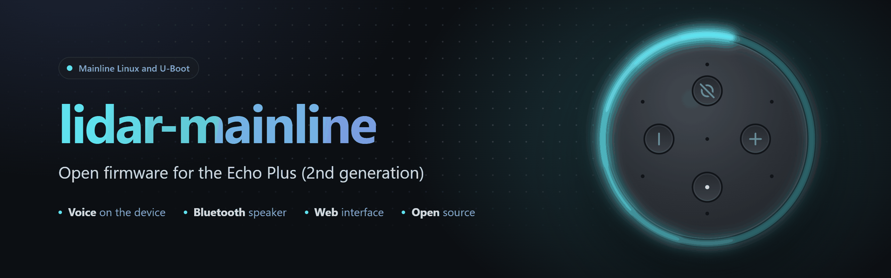

# lidar-mainline: U-Boot and mainline Linux for the Echo Plus 2nd gen

Mainline Linux v7.3 and U-Boot v2026.10 for the Amazon Echo Plus 2nd gen
(codename "lidar", MediaTek MT8516). It covers the bootloader, the kernel, and
the driver work that runs **after** the unlock. There is no exploit or unlock
code here: the device must already run Kaeru LK, as installed by
[`davidwatters/echo-plus-2-unlock`](https://github.com/davidwatters/echo-plus-2-unlock).

On top of the kernel, a small Alpine-based system turns the Echo into a
Bluetooth speaker with Fire OS's own speaker tuning, a light ring that shows
the volume, the talker's direction or the music, a Zigbee and Thread radio for
Home Assistant, a web interface served by the Echo itself and an experimental
voice assistant that listens on the device. No account, no app, no cloud
service in between (except Claude, if you give it your own API key).

**[Install in your browser](https://leagueraini.github.io/lidar-mainline/install.html)**
· [Install by hand](docs/install.md) · [Status](docs/status.md) ·
[Documentation](docs/README.md)

## Install

The browser installer flashes U-Boot and the test system over WebUSB from a
desktop Chromium browser (Chrome, Edge, Brave, Opera):
<https://leagueraini.github.io/lidar-mainline/install.html>. You need:

- an Echo Plus 2nd gen that is already unlocked and runs Kaeru LK;
- your own full eMMC dump from the unlock, at least `boot_a`;
- a USB connection to the test points TM4, TM5 and TM37, e.g. with pogo
  pins ([`pogo-jig/`](pogo-jig/) is a printable jig);
- for the manual way instead: `fastboot` (Android platform-tools).

The manual steps with `fastboot`, the shell over USB and the way back:
[docs/install.md](docs/install.md). The browser installer has not been tried
on an Echo yet; its caveats are listed there too.

> [!WARNING]
> Early test release. You flash your own device at your own risk, with no
> warranty. Keep your own `boot_a` dump: it is the way back to Fire OS. The
> pad **TM33 carries about 17 V** (the adapter rail) right next to the USB
> pads: never connect logic-level tools to it and do not bridge it to its
> neighbours. Never flash `lk_*`, `tee*`, `expdb`, `kb` or `dkb`.

## Status

✅ working · ⚠️ works, known issue · 🧪 needs testing on hardware ·
🛠️ planned · ➖ not planned

| Area | lidar-mainline |
|---|---|
| Boot | ✅ U-Boot after Amazon LK, USB fastboot, A/B slots with automatic fallback, recovery through Kaeru fastboot |
| CPU, eMMC | ✅ 598 MHz to 1.3 GHz with voltage scaling, HS200 eMMC; ➖ deep idle and suspend |
| Speaker | ✅ two-way crossover, Fire OS's speaker tuning, one system volume for buttons, phone and web interface |
| 3.5 mm line-out | ⚠️ works; the start-of-stream crack is not re-tested |
| Microphones | ✅ all 7 with the echo-cancellation reference; beamforming experimental |
| Wi-Fi, Bluetooth | ✅ 2.4 and 5 GHz; Bluetooth speaker for phones (A2DP, SBC and AAC) |
| Zigbee and Thread | ✅ both at once on the EFR32, for Home Assistant (images you build yourself only) |
| LED ring, buttons, sensors | ✅ boot animation, mute red, volume arc, sound display; privacy latch; light and temperature sensors |
| Web interface | ✅ status, music, every setting, first-run setup, optional login |
| Voice assistant | 🧪 experimental: wake word "Hey Jarvis" with its direction on the ring, on-device speech recognition and speech, timers, alarms, music, English and German; Claude for the rest |
| Alexa cloud services | ➖ |

Every feature against stock Fire OS: [docs/status.md](docs/status.md).

## Documentation

- [Install](docs/install.md): prerequisites, flashing, shell, recovery, the
  browser installer.
- [Building](docs/building.md): build container, `build.sh` targets,
  releases, pinned downloads.
- [Status](docs/status.md): every feature against stock, upstreaming.
- [Hardware](docs/hardware.md): test points, hardware status, LED ring
  orientation, bring-up checklist.
- [U-Boot and the boot chain](docs/uboot.md): what LK requires, U-Boot's
  behaviour, A/B updates.
- [Services](docs/services.md): `lidar-feature`, every service and
  setting, files from Fire OS, LED ring, Zigbee and Thread.
- [Audio](docs/audio.md): system volume, speaker tuning, Bluetooth
  speaker, sound display.
- [Web interface](docs/webui.md): views, API, first-run setup, login.
- [Voice](docs/voice.md): wake word, assistant, Claude, speech models,
  recognition and output.
- [Development](docs/development.md): repository layout.

## Building

Everything builds in a Debian container with `podman`: `build.sh uboot`,
`linux lidar`, `testimg lidar` and friends; see
[docs/building.md](docs/building.md).

## Licence

Mostly `GPL-2.0-only`; the kernel and U-Boot overlays keep their upstream
licences, and some parts are under other free licences. Release images
contain no Silicon Labs software. Details, including everything downloaded
at build time: [LICENSING.md](LICENSING.md).

## Not affiliated

An independent project, not affiliated with, endorsed by or sponsored by
Amazon, MediaTek, Silicon Labs, Anthropic or Apple. Echo and related marks
are trademarks of Amazon.com, Inc. or its affiliates; Claude is a product of
Anthropic. Other names are trademarks of their owners.
