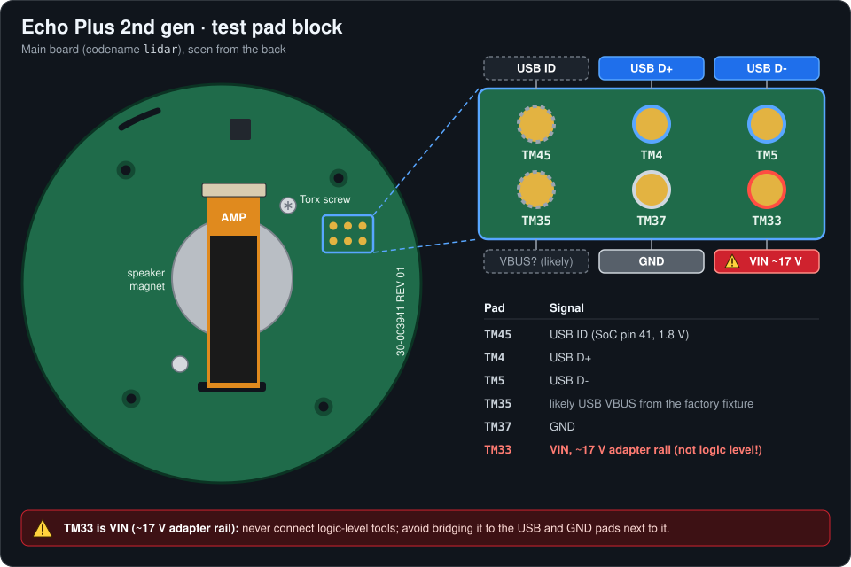

# Hardware

[Documentation](README.md) · [Project README](../README.md)

## Test points

The USB and supply pads form a 2x3 block next to the AMP flex cable:

| Pad | Signal | Notes |
|---|---|---|
| TM4 | USB D+ | device-mode USB to the host |
| TM5 | USB D- | |
| TM37 | GND | |
| TM58 | UART0 TX | 1.8 V, 921600 8N1, kernel and bootloader log |
| TM33 | VIN, about 17 V (adapter rail) | next to USB D+/D- and GND: never connect logic-level tools, and avoid bridging it to neighbouring pads |
| TM45 | USB ID | SoC pin 41 (KPROW1, function `IDDIG`), 1.8 V logic; follows the pin's internal pull (1.8 V with pull-up, 0 V with pull-down). Pulled up by default (device role); leave unconnected |
| TM35 | probably USB VBUS from the factory fixture (unused) | near 0 V. Not a SoC GPIO: no response to pull changes on any free GPIO, and not UART0 RX. Unpowered: open to GND with the pad positive (even on 2 MΩ), ~600 Ω and a 0.61 V diode drop with GND positive, i.e. only a diode to ground. 5 V through 10 kΩ changed nothing the SoC can see (GPIO inputs, USB PHY monitor, MUSB DEVCTL); the board has no MT6392 PMIC to sense VBUS. Leave unconnected |

UART0 RX has not been found yet: none of the pads identified so far carries
it (TM35 was checked). No UART input is needed, see [U-Boot behaviour](uboot.md#u-boot-behaviour).

## Hardware status

- **Boot time:** U-Boot records its stages against the SoC counter, which
  runs from reset, and hands them to Linux (`/proc/device-tree/bootstage`).
  Measured with a PC on the USB port: U-Boot starts 12.1 s after reset,
  Linux at 14.5 s, the boot finishes about 4 s later. The static blue ring
  is LK's, as on stock, and stays until the kernel takes over the LEDs.
  - Preloader (9.2 s in a stock UART log): 8 s of it wait for a flash tool
    because a USB host is attached (`USB enum timeout (8000ms)`). With only
    the power supply there is no such wait. A host with a driver bound to
    the preloader port (VID `0e8d`, PID `2000`; Linux does this by itself)
    cuts it to the 2.5 s handshake timeout.
  - LK with Kaeru, about 3 s: a 1.7 s key check and 0.8 s reading boot_a.
    These stages are not changed here (`lk_*` is never written).
  - U-Boot, 2.4 s: init 1 s, loading kernel and initramfs 0.7 s, unpacking
    0.7 s. Three changes took Linux from 17.5 s to 14.5 s after reset:
    - no autoboot delay;
    - the initramfs only carries the modules in
      `tools/initramfs-modules.txt` and their dependencies (111 of 801),
      which also cut the kernel's unpacking from 1.4 s to 0.95 s;
    - U-Boot's eMMC driver uses DMA on MT8516 (it ran PIO): about 40 MB/s
      instead of 13 MB/s. Verified before switching it on: DMA reads of
      kernel and initramfs were byte-identical to PIO reads, and a DMA
      write to a free area of `misc` read back identically.

    Installs from before this keep the autoboot delay saved in their
    environment; remove it with `fw_setenv bootdelay 0`.
- **Vproc / cpufreq:** working. The RT5738 reads die ID 0 and vendor ID 0
  (RT5739-class path). VSEL (GPIO9) is an input pulled high on the board, so
  the active bank is NSEL1 (`richtek,vsel-active-high`), as on stock.
  `mediatek-cpufreq` scales 598 MHz to 1.3 GHz. NSEL1 follows the clock in
  hardware: `0xb4` (1.20 V) at 1.04 GHz and `0xc8` (1.30 V) at 1.3 GHz,
  stable under a 4-core load.
- **CPU idle:** the stock kernel never uses PSCI cpuidle while more than one
  core is online; it only executes `wfi`. Its deep idle needs kernel-loaded
  SPM firmware plus CIRQ, and runs from the last online CPU only. With
  mainline's idle states the SoC never wakes. The board DT drops
  `cpu-idle-states`, which leaves plain WFI as on stock.
- **Wi-Fi/BT (`mmc2`):** three upstream bugs are fixed, and the controller now
  probes:
  1. The MSDC2 `source` and `hclk` clocks were swapped in `mt8516.dtsi`.
  2. `clk-mtk` sized the clock table by count, so IDs above 174
     (`MSDC2_INFRA`) were unreachable and the SDIO engine gate stayed off. The
     reset then spun forever.
  3. The infracfg reset bank (INFRA_RST0, bit 23 = MSDC2) was missing.

  The host setup matches Amazon's `mtk-sdio.c` in power sequence, clocks,
  divider, pins, pulls and drive. The test system stages the firmware and
  loads `wlan_mt76x8_sdio`, then `btmtksdio`, without manual steps. Verified
  on hardware: Wi-Fi scans on 2.4 and 5 GHz and connects (tested on 5 GHz:
  866 Mbit/s link, about 150 Mbit/s HTTPS download), Bluetooth finds classic
  and LE devices, both at the same time.
- **Wi-Fi and Bluetooth firmware:** both functions share one ROM patch.
  Amazon's (`mt7668_patch_e2_hdr.bin`, a 2025 build) crashes the Bluetooth
  firmware under mainline `btmtksdio`: its first LE or vendor command ends in
  a prefetch abort and a core dump streamed as packet type 0x80. The test
  image therefore ships the redistributable `mediatek/mt7668pr2h.bin` from
  linux-firmware (pinned by SHA-256) and uses it for Wi-Fi too. The Wi-Fi RAM
  code, calibration and settings stay owner-local: they come from the
  device's own Fire OS partition, and lidar keeps a copy on its slot
  ([Files from Fire OS](services.md#files-from-fire-os)). Never commit them.
  See [`lidar-wifi/README.md`](../lidar-wifi/README.md).
- **Bluetooth LE:** linux-firmware's patch leaves octets 25-28 of Read Local
  Supported Commands empty, i.e. all Bluetooth 4.0 LE commands, although it
  executes them. The core then never enables the LE Advertising Report and
  Connection Complete events, and LE scans find nothing. The `btmtksdio`
  overlay fills these octets in for the MT7668 when they arrive empty.
- **Wi-Fi / Bluetooth load order:** load `wlan_mt76x8_sdio` before
  `btmtksdio` (`softdep btmtksdio pre: wlan_mt76x8_sdio`). Mainline btmtksdio
  reads "patch download in progress" as "done", so bringing up `hci0` during
  the WLAN firmware download can fail.
- **Wi-Fi MAC:** stock reads it from Amazon IDME, which LK places as an
  `/idme` node in the devicetree it hands over. U-Boot copies
  `/idme/mac_addr` from there into `local-mac-address` on `&mmc2/wifi@1`
  (verified on hardware). The driver falls back to `wifi.cfg`, then eFuse,
  then a random `00:08:22:xx:xx:xx`.
- **LED ring:** LED n uses channels 3n-2, 3n-1 and 3n (R, G, B), named
  `ringN:red/green/blue`. Mainline `leds-is31fl32xx` was missing
  `brightness_steps` for the IS31FL3236, so brightness writes were dropped;
  this is fixed. The controller is the IS31FL3236A variant, run at 22 kHz
  PWM (`issi,22khz-pwm`) as stock does: the default 3 kHz was audible as a
  whine through the speaker whenever LEDs were lit.
- **Microphones:** all 7 mics capture with the `DIF_2L_3L`/`DIF_2R_3R`
  inputs and PGA 20 dB. Room noise is coherent between mic 7 (capture
  channel 6) and mics 1-6. Mic 7 also picks up narrow interference tones the
  other mics do not, so it needs filtering. Their frequencies differ between
  units: about 50 Hz, 130-144 Hz and 2.41 kHz on one, about 65, 120, 152 and
  316 Hz on another. Capture channel 7 is the line-in, which has not been
  tested with a real source.
- **Speaker:** a two-way system. The DAC's left channel drives the woofer
  and its right channel the tweeter, through the crossover Amazon's firmware
  loads into the DAC biquads:
  - woofer: low-pass, -3.5 dB at 1 kHz, inverted polarity
  - tweeter: fourth order high-pass, -3.4 dB at 3 kHz

  Both channels play the mono mix of the stream, from the line-out drivers.
  The machine driver loads the filters whenever the output route is Speaker
  (`DAC Biquad Coefficients`, `DAC Mono Mix Switch`), refuses the speaker
  route if they cannot be set, and limits playback to 48 kHz, the rate the
  coefficients are designed for. The DAC's MFP5 pin mutes the amplifier,
  which has no status output of its own. Measured with a USB microphone
  over the Echo: enabled unmuted, the amplifier pops loudly about 0.4 s
  after the enable; enabled muted it is silent, and an unmute is heard
  about 0.4 s after the pin changes. So it is enabled muted and unmuted
  500 ms later. Each direction still makes one faint click (about -40 dBFS
  at the microphone) that neither the order nor a longer delay (up to 2 s)
  removes: the unmute, and on power-down whichever of disabling and muting
  comes first (the other one is then silent). The driver disables first
  and then mutes, so the amplifier is muted for the next start. With the
  speaker output held open (`volume keepalive`) that is one click at boot
  and one at shutdown or reboot. Fire OS uses the same order: its audio HAL
  (`libalexaaudiohal.so`) enables the amplifier, unmutes it 400 ms later,
  and on close disables it and then mutes it. The HAL's speaker tables set
  nothing else on the amplifier, and the stock device tree gives the
  speaker path only GPIO105 (amplifier enable) and GPIO109 (output mux),
  with no amplifier supply regulator. The MCP4631 potentiometer at 0x2e on
  I2C bus 2, also in the stock device tree, does not acknowledge any read
  on the tested unit, so it plays no part in the amplifier sequence.
- **Line-out / headphones:** both channels work through the `Output Route`
  control (GPIO109 low = jack, amp off), now from the headphone drivers in
  plain stereo as on stock. Before that change every stream start made a
  loud crack; it has not been re-tested since.
- **Mic privacy:** the hardware latch is exposed as `SW_MUTE_DEVICE` (GPIO18)
  and the button as `KEY_MICMUTE` (GPIO108). Software can force privacy on
  through GPIO107 (active low). This is left released, and the line is free
  for userspace.
- **EFR32 (Zigbee + Thread):** needs no kernel driver. It talks to the SoC
  on `ttyS2` (115200, no flow control), with a Silicon Labs Gecko Bootloader
  (v1.0.0, XMODEM upload) in front of the application. Fire OS's
  `zb_migration_manager` shows the control lines: `EFR32_SWCLK` (GPIO1,
  rfkill `zigbee_swclk`) is the bootloader trigger (low = stay in the
  bootloader) and `EFR32_RESET_N` (GPIO13, rfkill `zigbee_reset`) the reset.
  Fire OS carries two images: `silabs/xncp-fw.gbl` (EmberZNet 6.5.3 NCP over
  ASH/EZSP) and `dsr/zb_mux_rcp.gbl` (DSR's OpenThread "dualpan" RCP), both
  unencrypted. Verified on hardware: with `EFR32_SWCLK` low, a pulse on
  `EFR32_RESET_N` brings up the bootloader menu, and its `2. run` starts the
  application again. ttyS2 needs the `8250_mtk.c` overlay: without it the
  UART stops transmitting for good once the EFR32 sends while the port is
  closed.
- **TSL2540 ambient light sensor:** new minimal IIO driver (`tsl2540`):
  visible and IR counts, gain and integration time. Verified on hardware:
  chip ID, configuration, and readings from 0 in the dark to about 7000
  counts under a torch (128x gain, 360 ms). Values are relative: the
  datasheet has no lux equation and the cover calibration is not ported.
  The `ring` service sets it to 256x gain and 0.72 s integration for its
  brightness control; with `ring auto_brightness off` the driver default
  (1x, 0.18 s) stays.
- **USB device port (MUSB):** two fixes in `drivers/usb/musb/` for
  isochronous gadget endpoints, which the serial shell and the network do
  not use:
  - Isochronous transfers through MUSB's Inventra DMA failed on MT8516 (IN
    produced no packets; root cause unknown), so isochronous endpoints use
    PIO there: a quirk (`MUSB_G_ISOC_NO_DMA`) set by the MediaTek glue only.
  - Isochronous packets that fail their CRC (`DATAERROR`) are dropped
    instead of being passed on with a garbage length. Over the pogo-pin
    connection to the test pads they happen several times per second.

## LED ring orientation

Orientation, seen from above: `ring1` sits at Volume down, `ring4` at the
microphone button, `ring7` at Volume up and `ring10` at Action, numbered
clockwise; each LED is slightly counter-clockwise of its button. In
`lidar-voice`'s frame (0° at mic 0, clockwise; mic 2 is by Action) a voice
from θ degrees (`doa`, in 10° steps) lights `ring` round((θ − 210) / 30)
mod 12 + 1.

## Bring-up checklist

From the test system's shell:

- `dmesg`
- `/sys/kernel/debug/gpio`
- `i2cdetect -y 0/1/2`: expect 0x18-0x1b, 0x39, 0x3f, 0x48 on bus 0; 0x57 on
  bus 1; and 0x18, 0x48, 0x4a on bus 2. Addresses with a bound driver show
  as `UU`, which does not prove the chip is there: 0x2e (MCP4631) shows `UU`
  too, but every read from it fails with no ACK
- `cat /sys/class/hwmon/*/temp1_input`
- LEDs in `/sys/class/leds/ring*:*/brightness`
- `evtest` for the buttons and the privacy switch
- the SDIO host MSDC2 (`&mmc2`, which appears as `mmc1`) enumerating the
  MT7668 as `mmc1:0001:1` in `/sys/bus/sdio/devices`

### Speaker tests

Start quiet: `amixer cset name='PCM Playback Volume' 47,47` (-40 dB), or
`lidar-volume set 20` with the `volume` service. The test image sets the
output drivers as Amazon does (line-out 0 dB, headphone +5 dB), so PCM
volume 127 (0 dB) is the speaker's full stock loudness. The control goes
up to 175 (+24 dB), and a desktop sound server using the UCM profile is not
bound by `lidar-volume`'s cap.
