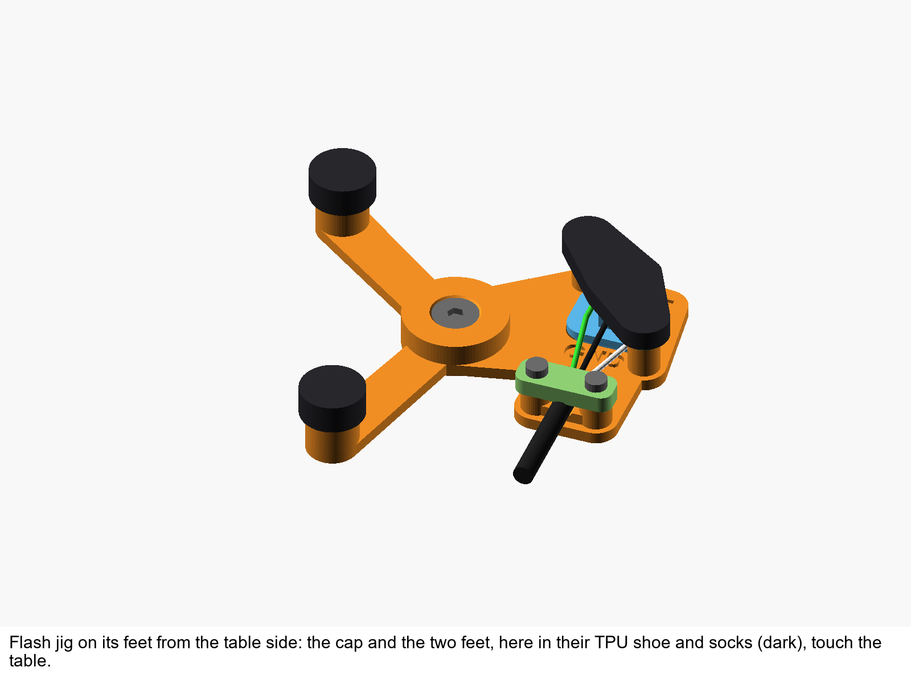
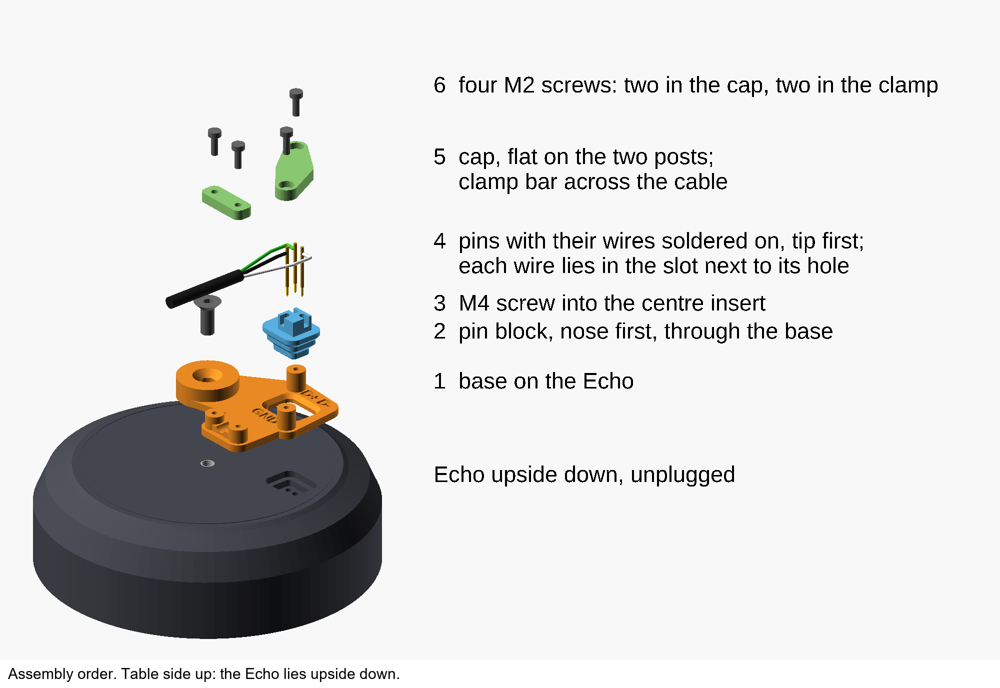
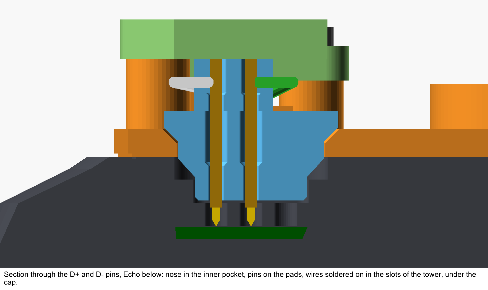
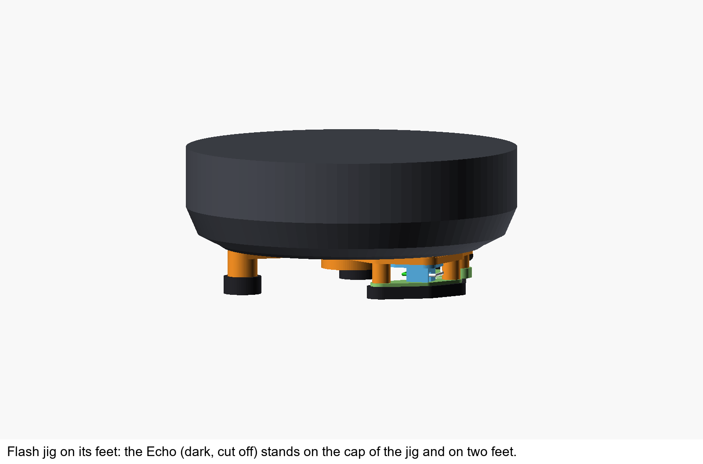

# Pogo-pin flash jig for the debug USB

A 3D-printed jig that puts three pogo pins on the USB test pads of the Echo
Plus 2nd gen (TM4 D+, TM5 D-, TM37 GND; see "Test points" in the top-level
README). The wires of a cut USB cable are soldered to the pins. Nothing is
soldered to the Echo, and there is no PCB. One M4 screw into the threaded
insert in the centre of the bottom holds the jig.

With the plain base the Echo lies upside down while the jig is on it; on the
base with feet it stands upright.

Status: a first print of this jig (same nose, pin positions and M4 fixing,
plain base) worked for flashing on one unit. The closed pin guides of the
tower, the cable clamp, the sunk cap screws, the base with feet and the TPU
soles were added after that print and are not confirmed on hardware yet.

Do the test fit in [CHECKLIST.md](CHECKLIST.md) (section 3) before soldering
anything: the window dimensions were measured on one unit.

## Parts

| Part | Qty | Notes |
|---|---|---|
| `stl/jig-base-feet.stl` | 1 | printed; 68 x 62 x 11.8 mm, 6.3 cm3. The base with two feet: the Echo stands upright on the jig's cap and the two feet |
| or `stl/jig-base.stl` | 1 | printed; 45 x 40 x 8.5 mm, 4 cm3. The base alone: the Echo lies upside down or on its side. Also the test-fit coupon |
| `stl/jig-pin-block.stl` | 1 | printed; 15 x 12 x 12.3 mm, with the pin tower. Depends on `pin_len` and `pad_depth` |
| `stl/jig-cap.stl` | 1 | printed; 22.5 x 23.5 x 3.4 mm, a flat plate with sunk screw heads |
| `stl/jig-cable-clamp.stl` | 1 | printed; 17 x 6 x 3 mm, the bar of the cable clamp. Depends on `cable_d` |
| `stl/tpu-cap-shoe.stl` | 1 | optional, printed in TPU; a 1.2 mm sole with a lip that stretches over the cap |
| `stl/tpu-foot-sock.stl` | 2 | optional, printed in TPU; a cup with a 1.2 mm sole for each foot of `jig-base-feet.stl` |
| P75-B1 pogo pin, 16 mm | 3 | 1.02 mm barrel, head no wider than 1.0 mm |
| M4 x 10 countersunk screw (DIN 7991 / ISO 10642) | 1 | sits in the countersink of the hub and reaches 4 mm into the 5 mm deep insert. Other length or a socket head: `m4_len`, `m4_head` |
| M2 self-tapping pan head screw, 6 or 8 mm | 4 | two for the cap, two for the cable clamp |
| USB 2.0 cable with a USB-A plug | 1 | to cut open. `cable_d` = 4.0 suits jackets from about 3.6 to 4.6 mm |

## Printing

Every part is exported as it lies on the bed. No supports.

- Base: flat face (the face that lies on the Echo) on the bed; the pin
  names end up on top.
- Pin block: nose face on the bed, tower up. Its sides lean out by up to 50
  degrees over 1.6 mm; print it with full part cooling.
- Cap: Echo side on the bed, so the recesses for the screw heads are on
  top. Clamp bar: either side down.
- PETG or PLA, 0.2 mm layers or finer for the block.
- The three pin holes in the block are 1.4 mm in the model and usually print
  smaller. A pin must slide through under its own weight: ream with a 1.1
  or 1.2 mm drill, or with a pin, by hand if it does not.

## How it works

The nose of the pin block fits the inner pocket of the window (10 x 7 mm,
4 mm below the bottom surface) and guides the pins into the pad holes. The
base holds the block and is screwed to the centre insert.

On its back the block carries a tower. Its lower part is a closed guide
around each pin, so the pins stand upright. Its top 3 mm is one slot per
pin: the solder joint and the wire lie in the slot and leave sideways, and
the walls between the slots keep the three joints apart.

The cap is a flat plate screwed to two posts of the base. The pin ends stand
against it, so it takes the spring force and sets the compression (1.6 mm of
2.5 mm travel).

The cable is held by a clamp on the base, 24 mm from the window: a cradle
between two posts and a bar screwed onto them, which presses the jacket flat
by 0.6 mm. The wires between the clamp and the pins are about 20 mm long and
carry no load.

## Soldering the wires to the pins

Do this on the bench, pins out of the jig.

1. Cut the cable, leaving the USB-A plug and as much cable as you want.
   Remove 30 mm of the outer jacket. Cut the shield foil, the braid and the
   bare drain wire off flush with the jacket.
2. Cut the red wire (VBUS, 5 V from the PC) off flush as well and put tape
   or heat-shrink over the jacket end. It is not connected and must not
   touch anything.
3. Check the remaining colours with a multimeter against the plug; they are
   a convention, not a guarantee. USB-A plug: the two outer, longer contacts
   are 1 VBUS (red) and 4 GND (black); of the two inner ones, 2 D- (white)
   is next to VBUS and 3 D+ (green) is next to GND.
4. Strip 3 mm of green, white and black and tin them.
5. Solder each wire to the side of a pin barrel, within 2.5 mm of the closed
   end (the end without the plunger): that is the part that lies in the
   slot. Nothing may stick out past the end face, and the end face itself
   must stay clean: it stands against the cap. Keep the joint slim (it has
   to fit a 1.8 mm wide slot) and the iron on for 1 to 2 seconds only; no
   flux near the plunger end.

## Putting it on the Echo

Echo unplugged, upside down on a cloth.

1. Lay the base on the bottom, hub over the centre insert, the opening over
   the window. The pin names are now readable: `D+ D-` on one long side of
   the opening, `GND` on the other.
2. Drop the pin block through the opening, nose first, tower up. It has to
   go into the window and sit down in the cone of the base. Its three
   holes: two on the `D+ D-` side, one on the `GND` side, under the `D+`
   hole. There is no hole over the bottom right (17 V) pad; if the holes do
   not match the names, the block is turned by 180 degrees.
3. M4 screw through the hub, finger-tight plus a quarter turn.
4. Insert the pins, tip first, each with its wire in the slot next to its
   hole. With the names on the base upright: green (D+) in the hole whose
   slot opens to the left, white (D-) in the one that opens to the right,
   black (GND) in the one that opens towards the `GND` name. Turn each pin
   so its joint points into the slot. The pins then stand upright by
   themselves, about 1.6 mm above the tower.
5. Lead the three wires towards the `GND` side and lay the cable into the
   cradle of the clamp, with the end of the jacket just on the pin side of
   the cradle.
6. Lay the cap flat on the pin ends, recesses up, and press it down onto
   its two posts. That compresses the pins by 1.6 mm. Two M2 screws, snug,
   not tight; their heads end below the face of the cap.
7. Clamp bar across the cable, two M2 screws, until the bar sits on both
   posts.
8. Checklist section 4, then section 5.

Taking it off: undo the M4 screw and lift the whole jig. It stays
assembled, and the clamp holds the cable. To put it back, set the nose into
the window and tighten the M4 screw.

## Standing the Echo up: the base on feet

The cap of the jig is flat on its table side, so the jig itself is one
foot. `jig-base-feet.stl` is the same base with two flat arms from the hub,
each ending in a round foot exactly as high as the cap.

- The Echo stands on three points, so it cannot rock: the cap and the two
  feet. It sits 11.85 mm above the table; the cable clamp and its screw
  heads end 0.65 mm above the table.
- The feet are under the Echo's flat bottom, 34 mm from the centre, and are
  hidden by the body. The tipping edge is 19 mm from the centre at its
  nearest; the bare Echo stands on about 37 mm. It tips earlier than the
  bare speaker if it is knocked.
- Optional TPU soles: `tpu-cap-shoe.stl` stretches over the cap and
  `tpu-foot-sock.stl` (print two) over each foot. They give grip on the
  table and keep the speaker from buzzing on hard plastic. All three soles
  are 1.2 mm thick, so the jig is level with all of them on or all of
  them off, and 1.2 mm higher with them. Print them sole down; pull the
  shoe off to reach the cap screws.
- Assemble with the Echo upside down as above, then turn it over.

## What to expect from it

- No ESD protection: touch something grounded before handling it.
- The Echo decides the speed and tries USB high speed. With the green and
  white wires kept twisted up to the pins that normally works. If the device
  connects and drops, or does not enumerate, put a USB 1.1 hub or a
  full-speed USB isolator between the cable and the PC: that forces
  12 Mbit/s, which is enough for a serial console and fastboot.

## Safety properties

- 17 V pad (bottom right, TM33): the pin block is solid there, including
  its tower. `pogo-jig.scad` refuses to build a pin layout that has a pin
  on that pad.
- Pin block turned by 180 degrees in the window (it is symmetric, so this is
  possible by hand): the D+ pin lands on the GND pad, the D- pin on the
  bottom left pad, the GND pin on the D+ pad. The 17 V pad then faces the
  one corner of the block that has no hole either; the model asserts this
  too. In the base the turned block still seats, so check step 2 above.
- VBUS goes nowhere: the red wire is cut off at the jacket.
- Nothing connects to the two other pads of the block (TM45, TM35).

## Changing it

Every dimension is a single line in `params.scad`; `pogo-jig.scad` asserts
on impossible combinations. The model is built in the device frame (looking
at the bottom of the Echo with the label upright: x right, y up, z out of
the Echo) and is never mirrored.

    python build.py [--openscad PATH] [--no-renders]

writes `stl/` and `renders/`. The STL export works with OpenSCAD 2021.01 or
later; the renders need a 2024 or later build and Pillow.
